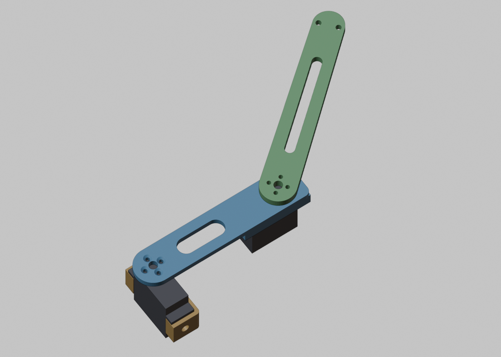
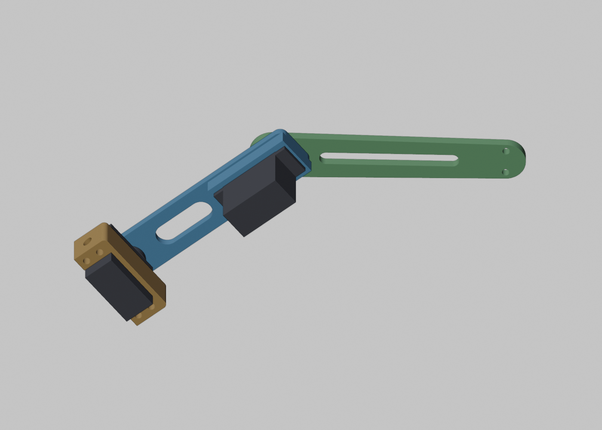

# Rubble Dog legs (hip, femur, tibia)

Printable leg parts for the rubble search robot dog, adapted from `Robot_Parts_Athena`.
The body, face, butt, and electronics parts are not changed yet; keep using the Athena files for those.




## What changed from Athena

Athena put both leg servos (hip and knee) side by side in the pelvis and drove the knee with a 110 mm tie rod.
This leg puts one servo at the hip and one servo at the knee, directly above the tibia.
The tie rod is gone.

Each leg has 3 DSServo 45kg servos (12 in total):

| Joint | Servo location | Turns |
| --- | --- | --- |
| Abduction | Athena body (unchanged) | the hip, about the body's long axis |
| Hip | in the hip part | the femur |
| Knee | in the femur cradle, at the knee | the tibia, directly |

The link lengths are the same as Athena, so the inverse kinematics numbers stay the same:

- Hip axis to knee axis: 110 mm.
- Knee axis to the foot bolt holes: 140 mm.

## Parts

| File | Print | Notes |
| --- | --- | --- |
| `stl/rubble_hip-left_1.0.stl` | 2 | Fore-left and hind-right legs. Athena pelvis cut down to the one slot on the abduction axis. Body-side holes match Athena |
| `stl/rubble_hip-right_1.0.stl` | 2 | Fore-right and hind-left legs. Mirror image |
| `stl/rubble_femur_1.0.stl` | 4 | Same part on all four legs. Holds the knee servo |
| `stl/rubble_tibia_1.0.stl` | 4 | Same part on all four legs. The tip is 6 mm thick with 2 holes 15 mm apart, so the Athena foot (`ares_feet-foot_1.0`) still fits |

`step/` has the same parts as STEP for editing in Fusion or Onshape.
`renders/` has views of each part.

## Print settings

All parts fit flat on the FlashForge Adventurer 5M (220 x 220 mm).
Start from the settings Matthew used for Athena (PLA, 220 C, 0.2 mm layers, 50% grid infill), with these changes for the load-bearing parts:

- Femur and tibia: 4 perimeters, so the screw holes have solid walls.
- Femur: print outer face down (the flat face with the 4 countersinks). The cradle builds upward with no supports.
- Tibia: print the flat outer face down, small round pad up.
- Hip: print flat, same as the Athena pelvis.

## Hardware per leg

- Hip servo to the hip: 4 screws through the tabs, same as the Athena pelvis (4.4 mm holes).
- Femur to the hip servo horn: 4x M3 x 8 flat head (countersunk), into the tapped horn holes.
- Knee servo to the femur: 4x M3 x 12, self-tapping into 2.8 mm pilot holes from the servo side.
- Tibia to the knee servo horn: 4x M3 x 10 button or socket head, into the tapped horn holes.
- Tibia to the Athena foot: 2 screws, same as Athena.
- 2x 25T aluminum disc horns (20 mm, 4x M3 on a 14 mm circle), with their center screws.

## Assembly

1. Set every servo to center (1500 us) before fitting a horn, so the zero position is known.
2. Fit the hip servo in the hip, spline toward the arm with the horn holes.
3. Fit the knee servo in the femur cradle from the inner side, top face against the plate, spline in the large hole. Screw the tabs down.
4. Fit a disc horn on each servo spline and tighten its center screw.
5. Screw the femur to the hip servo horn, with the femur pointing straight down.
6. Screw the tibia to the knee servo horn, with the tibia in line with the femur.
7. Bolt the hip to the Athena body the same way as the Athena pelvis.

## Measure before printing

The servo and horn sizes come from the DS3218 model in `Robot_Parts_Athena/3D_Objects/electronics`.
The 45kg servo is listed as 40 x 20 x 38.5 mm, so it should be the same footprint, but check these with calipers on one real servo with its horn and update `cad/params.py`:

- Body length and width (`SERVO_L`, `SERVO_W`).
- Spline axis to the near end of the body (`SERVO_SPLINE_FROM_END`).
- Top face to the top of the mounting tabs (`SERVO_TOP_TO_TAB`). This sets the cradle depth.
- Tab hole spacing, both directions (`SERVO_TAB_HOLE_L`, `SERVO_TAB_HOLE_W`).
- Servo top face to the outer face of the seated horn (`HORN_FACE_ABOVE_TOP`). This sets the gap between the femur and the tibia.

## Regenerate the files

The parts are parametric CadQuery code in `cad/`.
Change a value in `cad/params.py`, then rebuild:

```
pip install -r cad/requirements.txt
cd cad
python build.py            # writes step/ and stl/
python check_assembly.py   # sweeps the hip and knee joints and reports collisions
```

`check_assembly.py` checks the leg against itself: the hip, both servos, the femur, and the tibia.
With the current numbers, both joints are free through the full 360 degrees, because the tibia, the femur, and the knee servo each sit in their own layer and the knee servo stays at least 73 mm from the hip axis.
It does not include the Athena body, so check the knee servo against the body when the femur swings toward it.

## Open questions

- Wheels: the mecanum wheel and DC motor module will bolt to the tibia tip (the same 2-hole pattern as the Athena foot) once the motor and wheel sizes are measured.
- The joint range limits for the software depend on the body, the wiring, and how far the knee can fold before the foot hits the femur. Set them in the robot config after a dry fit.
