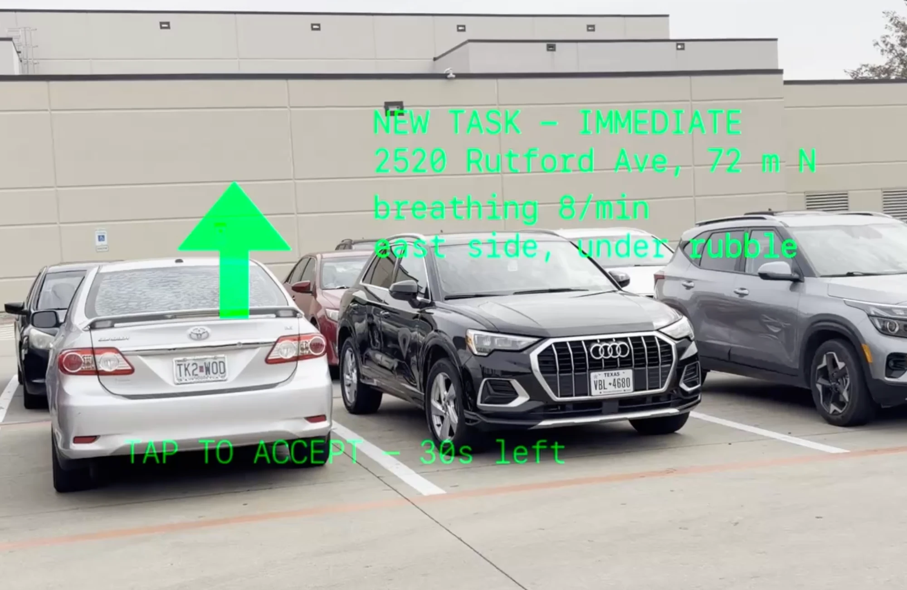
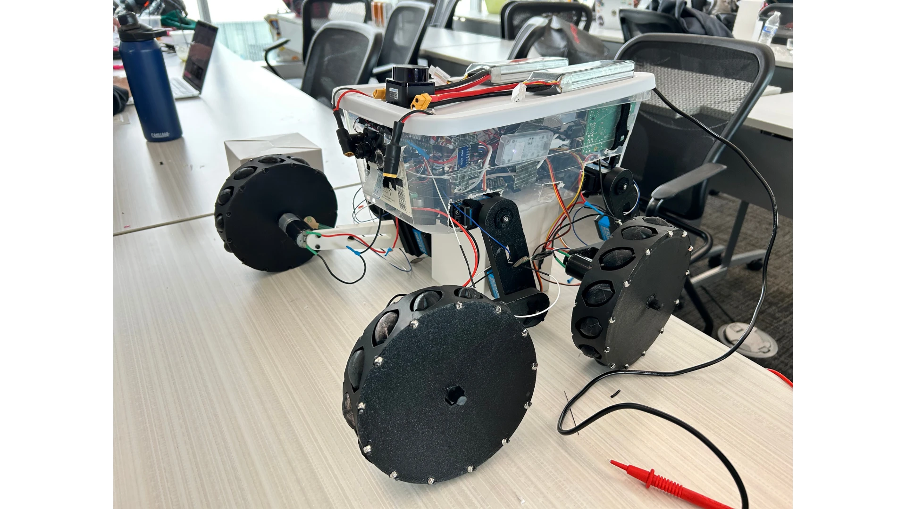

# Underdog

<p align="center">
  
  
</p>

**An AI-powered drone and robot dog team that searches disaster rubble, finds survivors with thermal imaging, checks if they are breathing, and guides rescuers wearing smart glasses to the people who need help most.**

*Scout first. Reduce human risk.* The drone scouts from above, then the robot dog goes in.

Built at HackUTD by Cayden Hutcheson, Matthew Beck, Eric Lee, and Camille.

Tracks: **NVIDIA** ("Use Nemotron Beyond a Chatbot"), **State Farm** ("The Worst Day, at Scale"), and **SpacetimeDB**.

---

## The problem

After an earthquake, tornado, or building collapse, rescuers face the same question at once in hundreds of places: where are the survivors, who is still alive, and who needs help first?
Searching collapsed buildings is slow and dangerous, and in the chaos, people get missed.

## What Underdog does

1. **The drone scouts from above.** Our drone sweeps the disaster area first, scanning the damage so the search starts where survivors are most likely to be.
2. **The robot dog goes in.** Our autonomous four-legged robot dog walks into the rubble the drone flagged, plans its own search path house by house, and maps the space with LiDAR.
3. **Finds people by heat.** The dog's thermal camera spots warm, person-sized shapes, even in the dark or under debris.
4. **Checks for breathing.** The dog stops, records a short video, and measures tiny chest movements to get a breathing rate. Eulerian video magnification makes that motion visible to humans.
5. **Scores how critical each person is.** Breathing, body heat, and how buried the person is combine into a triage level, so a barely visible person who cannot breathe well rises to the top.
6. **Coordinates the response.** NVIDIA Nemotron AI agents rank survivors, pick the nearest free rescuer, and plan where the drone and the dog search next.
7. **Guides rescuers.** Rescuers wearing Even Realities G2 smart glasses see how many critical survivors are nearby and an arrow pointing to the next one.
8. **Never drops anyone.** Every survivor stays on a live shared board until a human rescuer confirms them, partially searched areas stay queued for the drone or the dog, and timers escalate anyone left waiting.

```
  Drone (scouts from above)
      | area scan, priority zones
      v
  Robot dog                     SpacetimeDB (live database)              People
  ---------                     ---------------------------              ------
  thermal camera  --+                                              +-->  coordinator dashboard
  breathing video   +--> findings --> survivors, search areas,  ---+
  LiDAR, IMU, GPS --+               assignments, agent task board  +-->  rescuer smart glasses
                                          ^         |
                                          |         v
                                 Nemotron agents (orchestrator, auditor, comms)
```

---

## Technology

### NVIDIA Nemotron: agents, not a chatbot

Three AI agents run on Nemotron and work together through a shared task board, each with its own job and tools:

| Agent | Model | Job |
| --- | --- | --- |
| Orchestrator | `nemotron-3.5-super-vl-120b-a12b` | Ranks survivors, assigns rescuers, plans the drone's and the dog's search missions |
| Auditor | `nemotron-3.5-lightning-30b-a3b` | Independently reviews every orchestrator decision and flags bad ones |
| Comms | `nemotron-3.5-lightning-30b-a3b` | Writes short briefings for each rescuer's glasses |

The agents plan multi-step tasks and call real tools (database reducers), and they never steer the drone or the dog directly: they send high-level missions, and each robot's own safety system stays in charge.
Speech to text uses NVIDIA Riva.
See [docs/AGENT_WORKFLOW.md](docs/AGENT_WORKFLOW.md).

### SpacetimeDB: the whole backend

There is no separate web server or API. One SpacetimeDB module ([backend/spacetimedb/](backend/spacetimedb/)), published on Maincloud, runs everything:

- **Reducers** hold every rule. An agent can only propose what the rules allow, and a survivor cannot leave the board until a person resolves them.
- **Schedule tables** run every timer inside the database: rescuer leases, robot heartbeats, two-level escalation, and a watchdog that assigns rescuers if the agents go quiet.
- **Lifecycle reducers** (`client_connected`, `client_disconnected`) notice at once when a robot or a pair of glasses drops off the network.
- **Live subscriptions** mean the dashboard and every pair of glasses see the same board update instantly.
- **Agents and workers are ordinary clients** that coordinate through the `agent_task` table, so nothing is lost if one crashes.

### State Farm: the worst day, at scale

- **Most urgent needs first:** every survivor gets a critical score and a confidence.
- **Coordinated assistance:** the nearest free rescuer is assigned and guided with turn-by-turn direction on their glasses.
- **No one overlooked:** every search area must be searched by the drone or the dog, and every survivor stays tracked until a rescuer confirms them.

### The drone

The drone is the first layer of the search. It scans the disaster area from above, quickly covering ground no rescuer could walk in time, and marks the zones the robot dog should search first.
Its scans go into SpacetimeDB like every other finding, so the Nemotron orchestrator can send the dog where the drone saw the most need.

### The robot dog

The dog is the second layer: it goes where the drone cannot see, into and under the rubble.

- **Body:** four legs with 12 high-torque servos driven by inverse kinematics, plus mecanum wheels for fast travel on flat ground. 3D-printed parts.
- **Brain:** Raspberry Pi 4B running a C++17 state machine with a safety gate, fixed-rate control loop, and systemd watchdog.
- **Senses:** a Raspberry Pi Pico streams the MLX90640 thermal camera, LD19 360 degree LiDAR, TF-Luna LiDAR, IMU, and foot force sensors to the Pi. A camera captures breathing video, and GPS tags each find.
- **Link:** a Node.js bridge on the Pi connects the robot to SpacetimeDB.

### Perception

Python, FastAPI, OpenCV, and YOLO pose (Ultralytics) find the chest region, measure breathing from video motion, and compute the critical score.

### Smart glasses and dashboard

- **Glasses:** an Even Realities G2 plugin (Even Hub SDK, TypeScript, Vite). A glasses service draws a live map of the area when the rescuer is far away and switches to a direction arrow and distance when they get close.
- **Dashboard:** a React + Vite desktop app (Electron) for coordinators, with a live map, a ranked survivor list, and an Agents panel showing every agent decision as it happens.

---

## Repo layout

| Folder | What it is |
| --- | --- |
| [backend/spacetimedb/](backend/spacetimedb/) | SpacetimeDB module: tables, reducers, timers (TypeScript) |
| [backend/agent/](backend/agent/) | Nemotron agents: orchestrator, auditor, comms |
| [backend/perception/](backend/perception/) | Breathing detection and critical score (Python) |
| [backend/glasses-service/](backend/glasses-service/) | Renders the glasses views from live data |
| [backend/sim/](backend/sim/) | Simulator for the site, robot, and rescuers |
| [frontend/dashboard/](frontend/dashboard/) | Coordinator desktop app |
| [frontend/glasses/](frontend/glasses/) | G2 glasses plugin and fallback web view |
| [raspberrypi/](raspberrypi/) | Robot C++ program and SpacetimeDB bridge |
| [pico/](pico/) | Sensor firmware for the Pico |
| [3d_parts/](3d_parts/) | Robot body parts |
| [docs/](docs/) | Project plan, specs, and research |

Start with [docs/PROJECT.md](docs/PROJECT.md) for the full design and [docs/ROBOT.md](docs/ROBOT.md) for the robot.
