# Reference images

Reference photos for the EOG produced-water challenge, focused on water: tanks, pumps, SWD wells, brine spills, inspection robots, and thermal images.
Oil-only photos (pumpjacks, wellheads, crude spills) were removed on 2026-11-07.
More water-leak photos are in [water/](water/README.md), and more infrared and thermal photos are in [ir/](ir/README.md).
All files are from Wikimedia Commons or US federal agencies (USGS, EPA, GAO).
Files were downloaded at about 1280 px wide.

Attribution: CC BY and CC BY-SA images need credit wherever they are used, for example in the pitch deck or the app.
Use the attribution text in each table, with a link to the license.
CC BY-SA also requires that adapted versions (crops with overlays, edits) are shared under the same license.
Public domain and CC0 images need no credit, but giving it is good practice.

## 1. Tank batteries and produced-water storage tanks

| Image | What it shows | Author | License | Attribution text | Source |
| --- | --- | --- | --- | --- | --- |
| 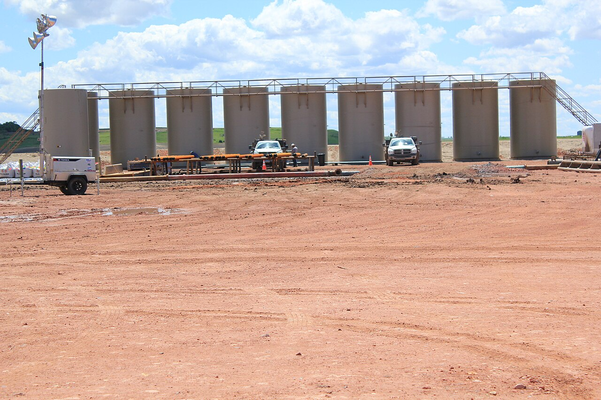 `tank-battery-williston-nd-01.jpg` | Oil field tank batteries near Williston, North Dakota (Bakken). | Lindsey G | [CC BY 2.0](https://creativecommons.org/licenses/by/2.0) | Photo: Lindsey G, CC BY 2.0, via Wikimedia Commons | [source page](https://commons.wikimedia.org/wiki/File:Williston_North_Dakota_Oil_Field_Tank_Batteries_%285894584980%29.jpg), [file](https://thumb.wikimedia.org/wikipedia/commons/thumb/f/fe/Williston_North_Dakota_Oil_Field_Tank_Batteries_%285894584980%29.jpg/1280px-Williston_North_Dakota_Oil_Field_Tank_Batteries_%285894584980%29.jpg) |
| 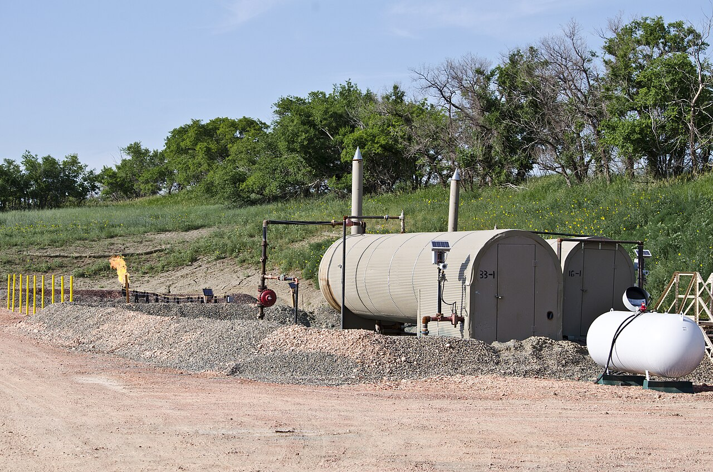 `produced-water-tanks-flare-nd-03.jpg` | Water (moisture) tanks and a flare at the Obenour 1 and 2 well pad, McKenzie County, North Dakota. | Tim Evanson | [CC BY-SA 2.0](https://creativecommons.org/licenses/by-sa/2.0) | Photo: Tim Evanson, CC BY-SA 2.0, via Wikimedia Commons | [source page](https://commons.wikimedia.org/wiki/File:Obenour_1_and_2_moisture_tanks_and_flare_-_Arnegard_North_Dakota_-_2013-07-04.jpg), [file](https://thumb.wikimedia.org/wikipedia/commons/thumb/e/e7/Obenour_1_and_2_moisture_tanks_and_flare_-_Arnegard_North_Dakota_-_2013-07-04.jpg/1280px-Obenour_1_and_2_moisture_tanks_and_flare_-_Arnegard_North_Dakota_-_2013-07-04.jpg) |

## 2. Transfer pumps and pump skids

No openly licensed photo of a pump skid at an actual tank battery or SWD facility was found.
These two show the same kind of equipment (a centrifugal pump driven by an electric motor) in other settings.
The West Virginia SWD photo in section 3 also shows the facility side of the system.

| Image | What it shows | Author | License | Attribution text | Source |
| --- | --- | --- | --- | --- | --- |
| 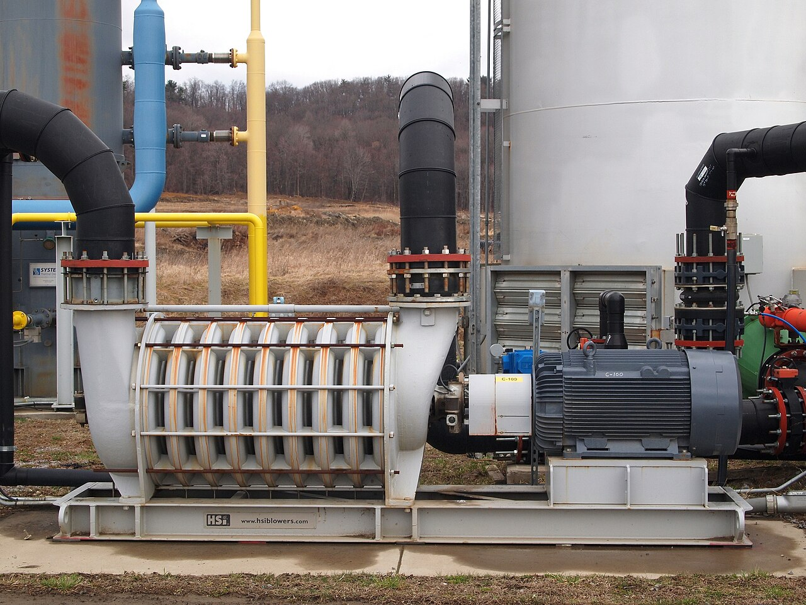 `transfer-pump-multistage-skid-02.jpg` | Horizontal multistage centrifugal pump on a skid with its motor (landfill gas service, but the same layout as a water transfer pump). | Z22 | [CC BY-SA 4.0](https://creativecommons.org/licenses/by-sa/4.0) | Photo: Z22, CC BY-SA 4.0, via Wikimedia Commons | [source page](https://commons.wikimedia.org/wiki/File:Multistage_centrifugal_pump.jpg), [file](https://thumb.wikimedia.org/wikipedia/commons/thumb/3/35/Multistage_centrifugal_pump.jpg/1280px-Multistage_centrifugal_pump.jpg) |

## 3. Saltwater disposal (SWD) facilities and injection wellheads

| Image | What it shows | Author | License | Attribution text | Source |
| --- | --- | --- | --- | --- | --- |
| 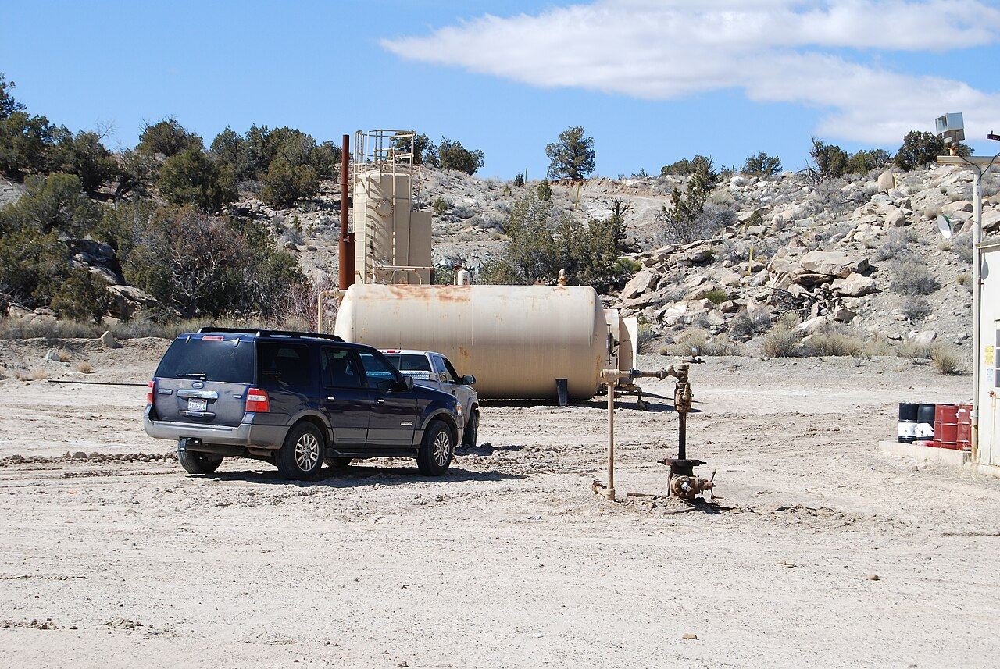 `injection-wellhead-tin-cup-01.jpg` | Water injection wellhead (Tin Cup 1-35). | trueblood | Public domain | trueblood, Public domain, via Wikimedia Commons | [source page](https://commons.wikimedia.org/wiki/File:Tin_Cup_1-35_Water_Injection_Well_631.jpg), [file](https://thumb.wikimedia.org/wikipedia/commons/thumb/8/82/Tin_Cup_1-35_Water_Injection_Well_631.jpg/1280px-Tin_Cup_1-35_Water_Injection_Well_631.jpg) |
| 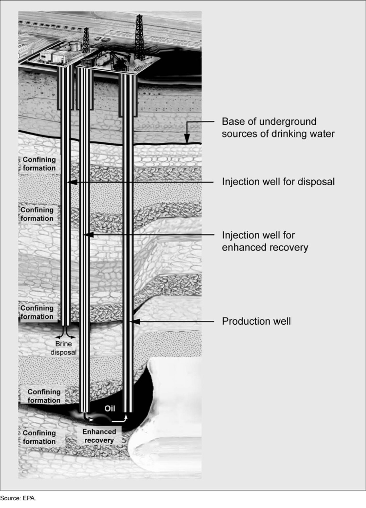 `injection-wells-produced-water-gao-02.jpg` | US GAO report figure titled Injection Wells for Produced Water (grayscale figure from GAO-12-156). | U.S. Government Accountability Office | Public domain | U.S. Government Accountability Office, Public domain, via Wikimedia Commons | [source page](https://commons.wikimedia.org/wiki/File:Figure_2-_Injection_Wells_for_Produced_Water_%286847703607%29.jpg), [file](https://thumb.wikimedia.org/wikipedia/commons/thumb/8/85/Figure_2-_Injection_Wells_for_Produced_Water_%286847703607%29.jpg/1280px-Figure_2-_Injection_Wells_for_Produced_Water_%286847703607%29.jpg) |
| 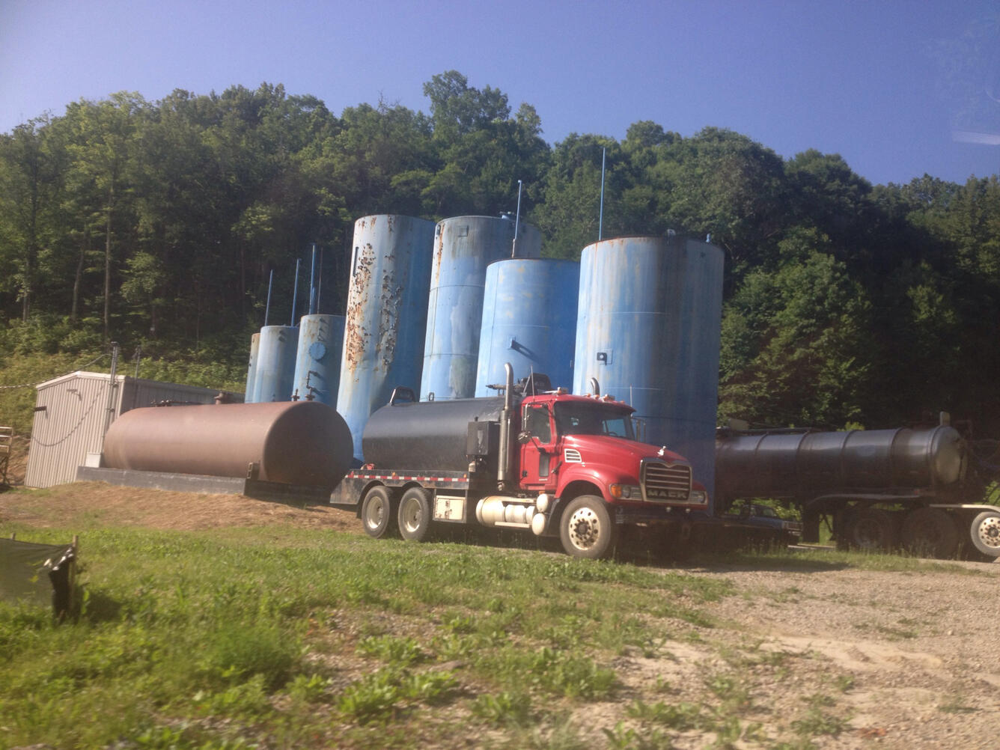 `swd-facility-tanks-truck-wv-03.jpg` | Class II injection well wastewater disposal facility in West Virginia with storage tanks and tanker trucks. | U.S. Geological Survey | Public domain | U.S. Geological Survey, Public domain | [source page](https://www.usgs.gov/media/images/class-ii-injection-well-wastewater-disposal-facility-storage-tank), [file](https://d9-wret.s3.us-west-2.amazonaws.com/assets/palladium/production/s3fs-public/styles/full_width/public/thumbnails/image/wv_disposal_facility_wvhf-06-061814_3_l_0.jpg) |
| 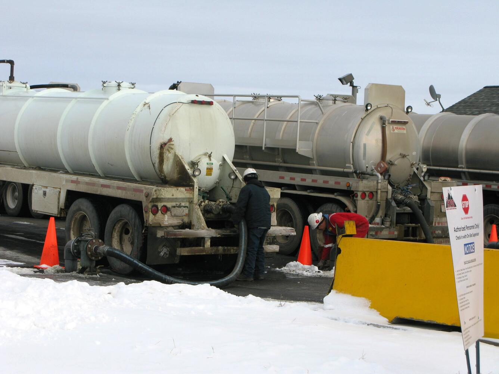 `swd-facility-tanker-colorado-04.jpg` | Oilfield wastewater disposal facility near Platteville, Colorado, with a tanker truck unloading. | U.S. Geological Survey | Public domain | U.S. Geological Survey, Public domain | [source page](https://www.usgs.gov/media/images/wastewater-disposal-facility-colorado-0), [file](https://d9-wret.s3.us-west-2.amazonaws.com/assets/palladium/production/s3fs-public/styles/full_width/public/IMG_7488.JPG) |

## 4. Produced water and brine spills, pipeline leaks

The two USGS images are a real produced-water (brine) pipeline spill.
The two EPA images are a crude oil pipeline spill, used here for spill-response visuals.

| Image | What it shows | Author | License | Attribution text | Source |
| --- | --- | --- | --- | --- | --- |
| 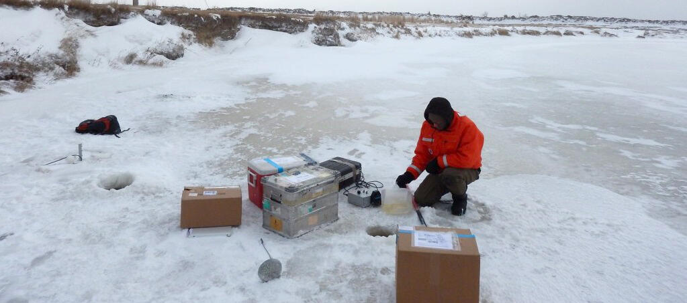 `brine-spill-sampling-blacktail-nd-01.jpg` | USGS scientists sampling after the January 2015 brine (saltwater) pipeline spill into Blacktail Creek, North Dakota. | U.S. Geological Survey | Public domain | U.S. Geological Survey, Public domain | [source page](https://www.usgs.gov/media/images/sampling-hydraulic-fracturing-brine-waste-spill), [file](https://d9-wret.s3.us-west-2.amazonaws.com/assets/palladium/production/s3fs-public/styles/full_width/public/thumbnails/image/hydraulic-fracturing-brine-spill-sampling_adj.jpg) |
| 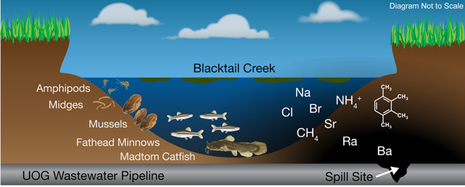 `brine-pipeline-leak-blacktail-nd-02.png` | USGS graphic for oil production wastewater that leaked from a pipeline into Blacktail Creek, North Dakota. | U.S. Geological Survey | Public domain | U.S. Geological Survey, Public domain | [source page](https://www.usgs.gov/media/images/wastewater-oil-production-williston-basin-leaked-a-pipeline), [file](https://d9-wret.s3.us-west-2.amazonaws.com/assets/palladium/production/s3fs-public/styles/full_width/public/media/images/wastewater_graphic.png) |

## 5. Robots and drones for inspection

None of these is at an oil and gas tank battery; the offshore ANYmal photo is the closest match.

| Image | What it shows | Author | License | Attribution text | Source |
| --- | --- | --- | --- | --- | --- |
| 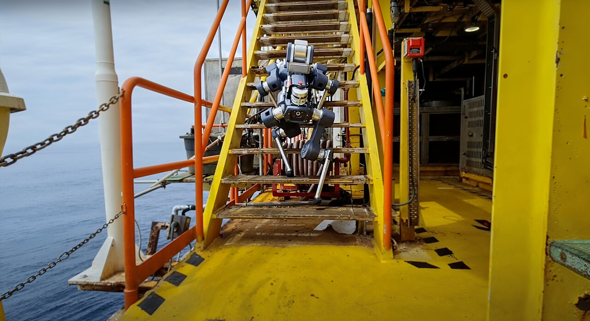 `robot-anymal-x-offshore-01.jpg` | ANYmal X legged robot on an offshore rig inspection round (visual, thermal, acoustic, and gas sensing). | Cvoellmy | [CC BY-SA 4.0](https://creativecommons.org/licenses/by-sa/4.0) | Photo: Cvoellmy, CC BY-SA 4.0, via Wikimedia Commons | [source page](https://commons.wikimedia.org/wiki/File:AnymalX-robot-inspection-offshore.jpg), [file](https://thumb.wikimedia.org/wikipedia/commons/thumb/4/48/AnymalX-robot-inspection-offshore.jpg/1280px-AnymalX-robot-inspection-offshore.jpg) |
| 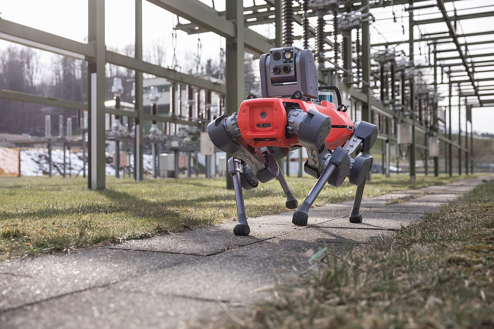 `robot-anymal-substation-02.jpg` | ANYmal D legged robot doing visual, thermal, and acoustic inspection in a power substation. | Cvoellmy | [CC BY-SA 4.0](https://creativecommons.org/licenses/by-sa/4.0) | Photo: Cvoellmy, CC BY-SA 4.0, via Wikimedia Commons | [source page](https://commons.wikimedia.org/wiki/File:Anymal-robot-inspection-power-grid.jpg), [file](https://thumb.wikimedia.org/wikipedia/commons/thumb/0/0a/Anymal-robot-inspection-power-grid.jpg/1280px-Anymal-robot-inspection-power-grid.jpg) |
| 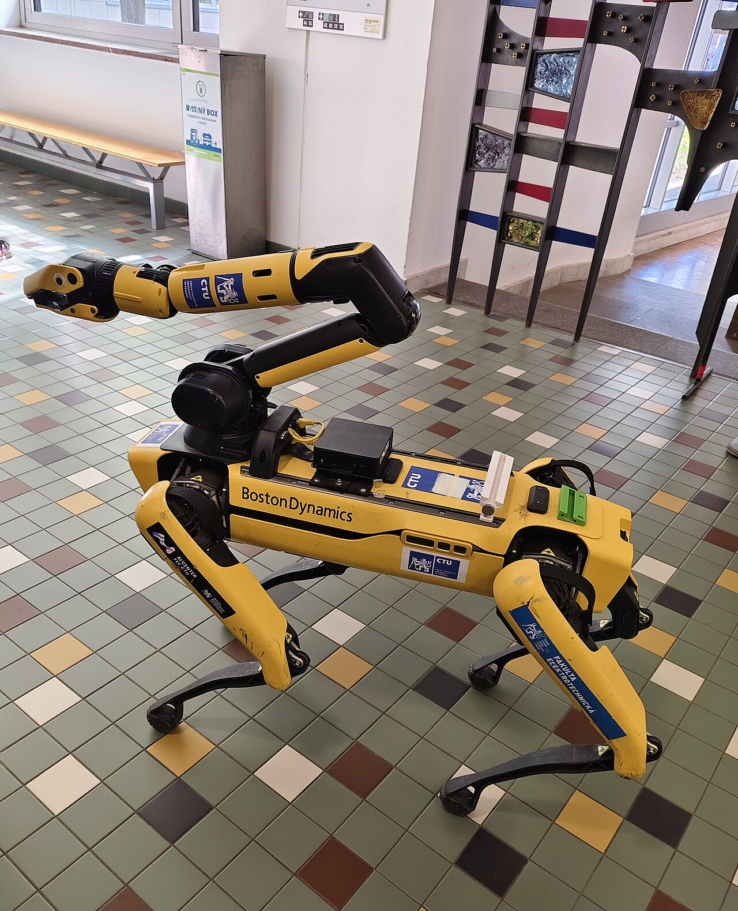 `robot-spot-arm-03.jpg` | Boston Dynamics Spot with a robotic arm, camera, and depth sensor at CTU Prague (lab setting). | Mojmir Churavy | [CC0](http://creativecommons.org/publicdomain/zero/1.0/deed.en) | Mojmir Churavy, CC0, via Wikimedia Commons | [source page](https://commons.wikimedia.org/wiki/File:FEL_CVUT_Technicka_2_Praha_6_Interier_R.jpg), [file](https://thumb.wikimedia.org/wikipedia/commons/thumb/0/06/FEL_CVUT_Technicka_2_Praha_6_Interier_R.jpg/1280px-FEL_CVUT_Technicka_2_Praha_6_Interier_R.jpg) |
| 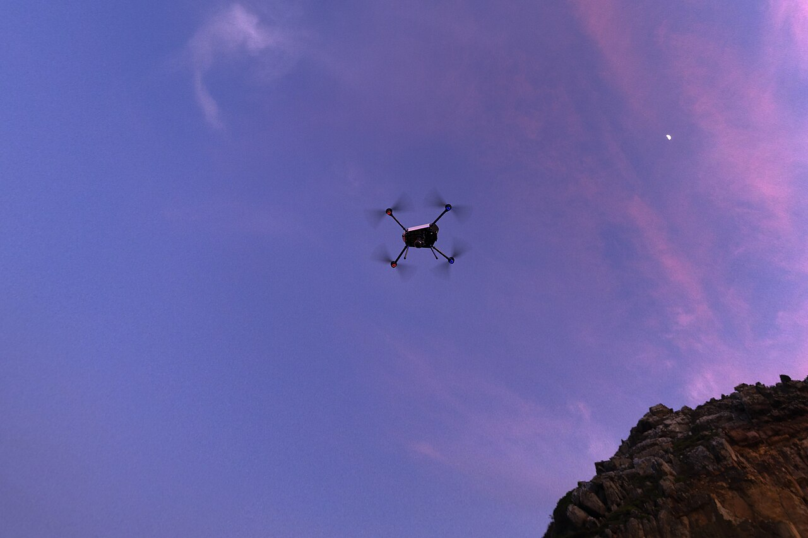 `drone-industrial-inspection-04.jpg` | Drone used for industrial inspection. | Medusasami | [CC BY-SA 4.0](https://creativecommons.org/licenses/by-sa/4.0) | Photo: Medusasami, CC BY-SA 4.0, via Wikimedia Commons | [source page](https://commons.wikimedia.org/wiki/File:EM120_inspection.jpg), [file](https://thumb.wikimedia.org/wikipedia/commons/thumb/a/a6/EM120_inspection.jpg/1280px-EM120_inspection.jpg) |

## 6. Thermal (infrared) images

| Image | What it shows | Author | License | Attribution text | Source |
| --- | --- | --- | --- | --- | --- |
| 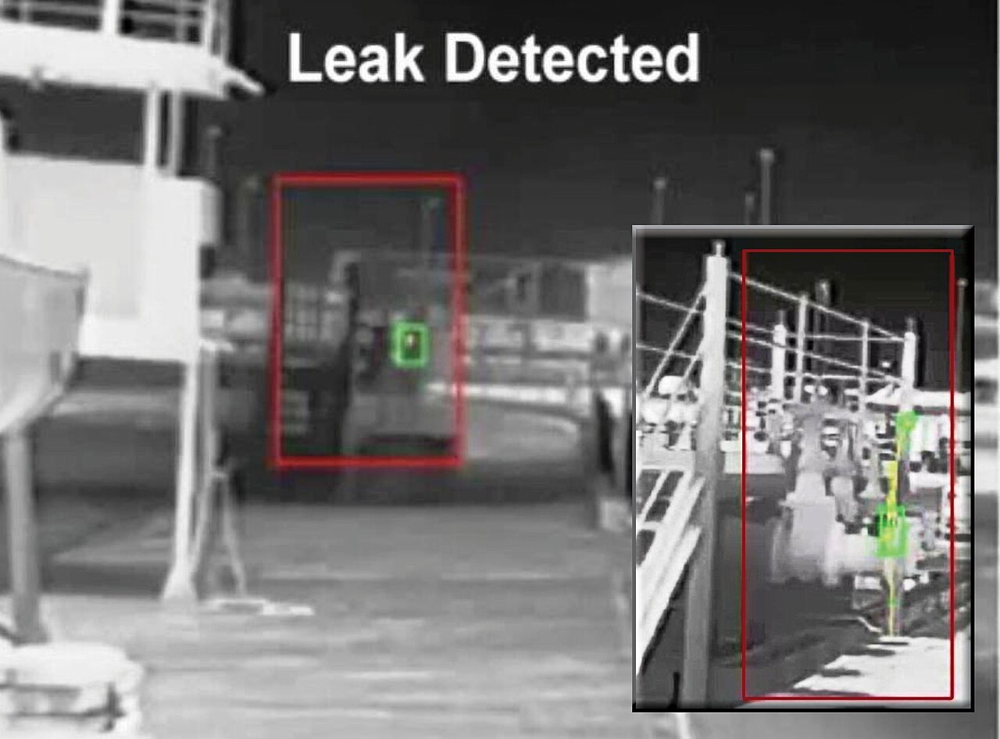 `thermal-flange-leak-01.jpg` | Thermal camera images of an oil leak from a flange, detected at 150 ft and 50 ft in heavy rain. | Intelliviewtech | [CC BY 3.0](https://creativecommons.org/licenses/by/3.0) | Photo: Intelliviewtech, CC BY 3.0, via Wikimedia Commons | [source page](https://commons.wikimedia.org/wiki/File:Diesel_flange_leak_detection_at150_ft_and_50_ft_in_heavy_rain_with_video_analytics_driven_thermal_camera_system.jpg), [file](https://thumb.wikimedia.org/wikipedia/commons/thumb/7/7f/Diesel_flange_leak_detection_at150_ft_and_50_ft_in_heavy_rain_with_video_analytics_driven_thermal_camera_system.jpg/1280px-Diesel_flange_leak_detection_at150_ft_and_50_ft_in_heavy_rain_with_video_analytics_driven_thermal_camera_system.jpg) |
| 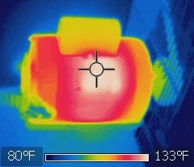 `thermal-electric-motor-02.jpg` | Thermal image of an electric motor showing heat loss (small, 240 px). | Zaereth | [CC0](http://creativecommons.org/publicdomain/zero/1.0/deed.en) | Zaereth, CC0, via Wikimedia Commons | [source page](https://commons.wikimedia.org/wiki/File:Electric_motor_thermal_image.jpg), [file](https://upload.wikimedia.org/wikipedia/commons/a/a3/Electric_motor_thermal_image.jpg) |
| 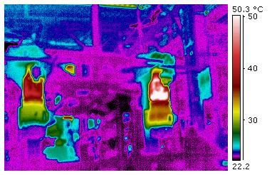 `thermal-motor-misinstalled-03.jpg` | Thermal image of a horizontal motor installed vertically, with bearing heat (small, 382 px). | Hotflashhome | [CC BY-SA 3.0](https://creativecommons.org/licenses/by-sa/3.0) | Photo: Hotflashhome, CC BY-SA 3.0, via Wikimedia Commons | [source page](https://commons.wikimedia.org/wiki/File:Horizontal_motor.jpg), [file](https://upload.wikimedia.org/wikipedia/commons/d/d6/Horizontal_motor.jpg) |

## Gaps

No photos of a real Permian Basin produced-water tank battery or SWD facility were found under an open license; the tank photos are from the Bakken in North Dakota.
The pump and robot sections use close analogs from other settings, as noted above.
The two motor thermal images are small (240 px and 382 px wide).
