# Infrared and thermal reference images

Reference pictures for the leak-check robot (HackUTD, Nov 2026).
All images were downloaded on 2026-11-07 from Wikimedia Commons, and each license was read from the file page.

## Near-infrared versus thermal

The Raspberry Pi NoIR camera sees near-infrared light (about 850 to 940 nm) that its IR LEDs shine onto the scene and that bounces back, so it works like a security night-vision camera and makes a gray picture of shapes and surfaces.
It does not see temperature, and a hot pump and a cold pipe look the same to it if they reflect the same amount of light.
Water absorbs near-infrared strongly, so standing water and wet ground often look darker than dry ground in NoIR images (see section 4).
The thermal sensor sees long-wave infrared (about 8 to 14 um) that objects emit because of their own temperature, so it needs no light and shows hot and cold areas, such as an evaporating puddle, a cold water line, or a hot bearing.
The thermal sensor has very few pixels (8x8 or 32x24 for this class), so it can say "this spot is colder than its surroundings" but it cannot show the detail that the images in sections 1 to 5 show (see section 6).

## License note

CC BY and CC BY-SA images need attribution wherever they are used, for example in slides, the demo video, or the Devpost page.
Use the "Attribution text" column and link the license.
CC BY-SA also requires that changed versions are shared under the same license.
CC0 and public domain images need no attribution, but credit is still good practice.
The "Attribution" license on `nir-cctv-active-ir-night-01.jpg` is a Commons free license that only requires credit to the copyright holder.

## 1. Thermal images of water leaks, wet surfaces, and water lines

| Image | What it shows | IR type | Author | License | Attribution text | Source |
|---|---|---|---|---|---|---|
| 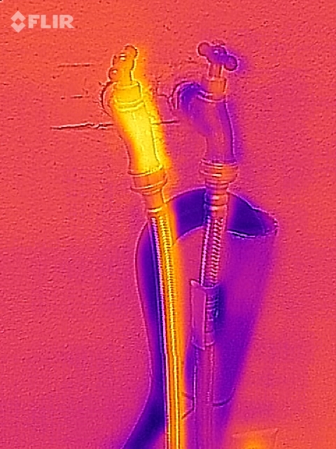 `thermal-hose-bibb-hot-cold-water-01.jpg` | Hot and cold outdoor hose taps (FLIR handheld); per the author, it is easy to see where the hot water comes from. A model for tracing a warm or cold fluid line. | Thermal (LWIR) | Daniel Ramirez from Honolulu, USA | CC BY 2.0 | Daniel Ramirez from Honolulu, USA, CC BY 2.0, via Wikimedia Commons | [File page](https://commons.wikimedia.org/wiki/File:Hot_water_%26_Cold_Water_hose_bibb_(17611609128).jpg), [direct file](https://upload.wikimedia.org/wikipedia/commons/0/04/Hot_water_%26_Cold_Water_hose_bibb_%2817611609128%29.jpg) |
| 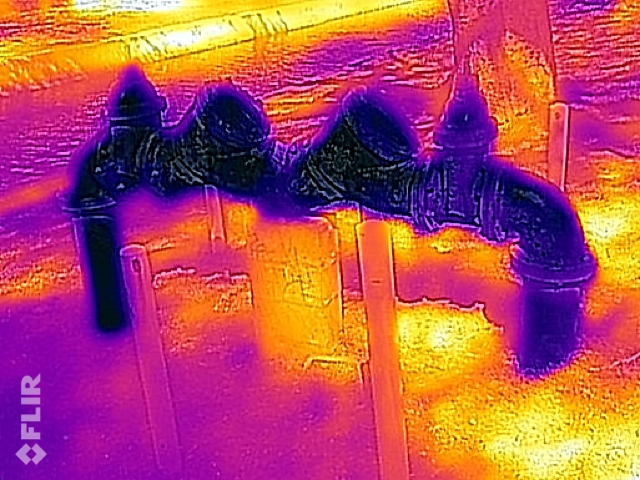 `thermal-backflow-preventer-cold-water-01.jpg` | Park backflow preventer; the valve body and pipes read cooler than surroundings because of the water flowing inside. | Thermal (LWIR) | Daniel Ramirez from Honolulu, USA | CC BY 2.0 | Daniel Ramirez from Honolulu, USA, CC BY 2.0, via Wikimedia Commons | [File page](https://commons.wikimedia.org/wiki/File:Backflow_preventer_at_the_park_(17611605118).jpg), [direct file](https://upload.wikimedia.org/wikipedia/commons/b/ba/Backflow_preventer_at_the_park_%2817611605118%29.jpg) |
| 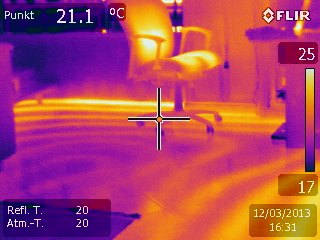 `thermal-floor-heating-pipes-01.jpg` | Hot-water floor heating pipes visible through the floor surface (FLIR E60), the same pattern a hidden hot-water leak makes. | Thermal (LWIR) | Herbertweidner | CC0 | Herbertweidner, CC0 (attribution not required), via Wikimedia Commons | [File page](https://commons.wikimedia.org/wiki/File:IR_Fussbodenheizung.jpg), [direct file](https://upload.wikimedia.org/wikipedia/commons/1/1e/IR_Fussbodenheizung.jpg) |
| 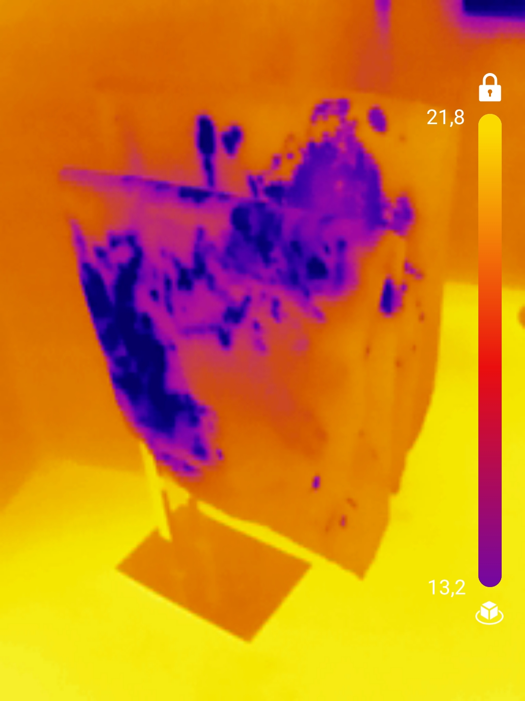 `thermal-wet-towel-evaporative-cooling-01.jpg` | Wet towel on a towel rail; the wet area is clearly colder from evaporative cooling (TOPDON TC001, 256x192 sensor). Key mechanism for spotting fresh wet ground or a puddle. | Thermal (LWIR) | Laserlicht | CC BY-SA 4.0 | Laserlicht, CC BY-SA 4.0, via Wikimedia Commons | [File page](https://commons.wikimedia.org/wiki/File:Handtuchhalter_nass_thermal.jpg), [direct file](https://upload.wikimedia.org/wikipedia/commons/d/db/Handtuchhalter_nass_thermal.jpg) |
| 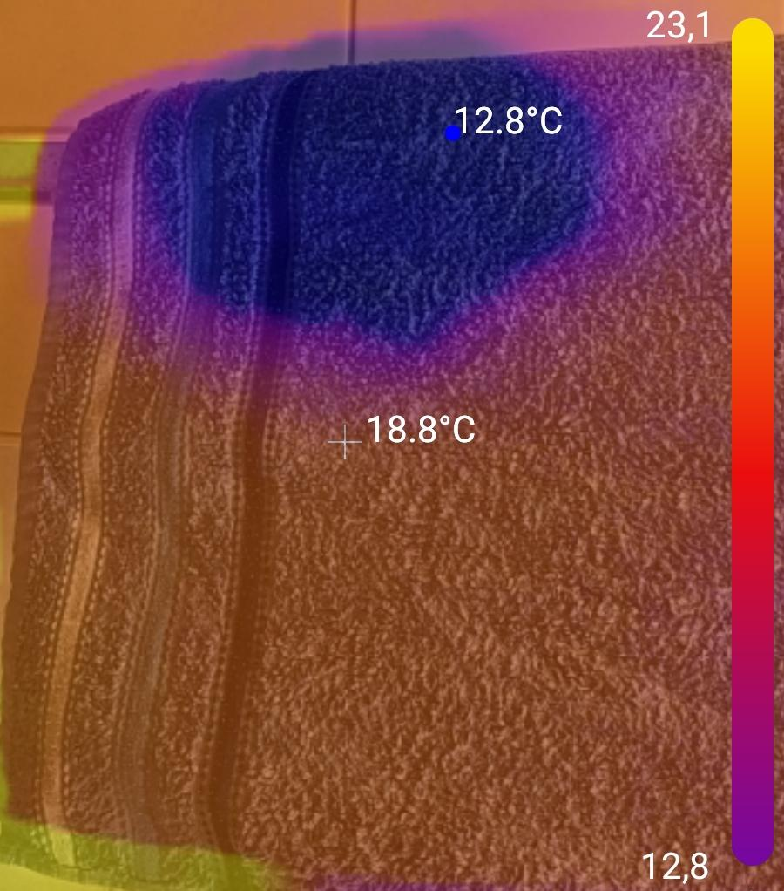 `thermal-wet-towel-evaporative-cooling-02.jpg` | Second wet-towel shot, thermal overlaid on the visible photo (author notes the overlay is not perfect); the wet fabric reads colder from evaporation. | Thermal (LWIR) overlay on visible | Laserlicht | CC BY-SA 4.0 | Laserlicht, CC BY-SA 4.0, via Wikimedia Commons | [File page](https://commons.wikimedia.org/wiki/File:Handtuch_Verdunstungsk%C3%A4lte.jpg), [direct file](https://upload.wikimedia.org/wikipedia/commons/c/c6/Handtuch_Verdunstungsk%C3%A4lte.jpg) |
| 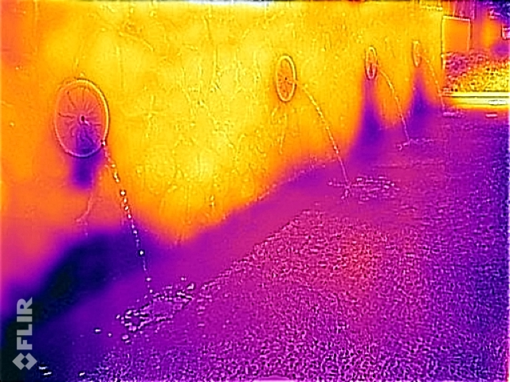 `thermal-water-feature-drips-01.jpg` | Wall fountain spouts; per the author, one spout has no drips unlike the other three, so small drips are visible in thermal. | Thermal (LWIR) | Daniel Ramirez from Honolulu, USA | CC BY 2.0 | Daniel Ramirez from Honolulu, USA, CC BY 2.0, via Wikimedia Commons | [File page](https://commons.wikimedia.org/wiki/File:Water_feature_on_rock_wall._(17176932364).jpg), [direct file](https://upload.wikimedia.org/wikipedia/commons/0/08/Water_feature_on_rock_wall._%2817176932364%29.jpg) |

## 2. Thermal images of liquid level in a container

No openly licensed thermal image of an industrial tank level was found, so these are small-container analogs of the same effect.

| Image | What it shows | IR type | Author | License | Attribution text | Source |
|---|---|---|---|---|---|---|
| 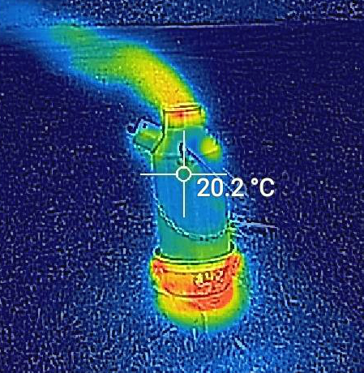 `thermal-kettle-cold-water-level-01.jpg` | Camping kettle filled with cold water just after lighting; the cold water should contrast with the heated metal (CAT S60 phone, Lepton-based). Closest analog to the tank-level trick. | Thermal (LWIR) | Prosthetic Head | CC BY-SA 4.0 | Prosthetic Head, CC BY-SA 4.0, via Wikimedia Commons | [File page](https://commons.wikimedia.org/wiki/File:Ghillie_Kettle_Thermal.jpg), [direct file](https://upload.wikimedia.org/wikipedia/commons/d/d8/Ghillie_Kettle_Thermal.jpg) |
| 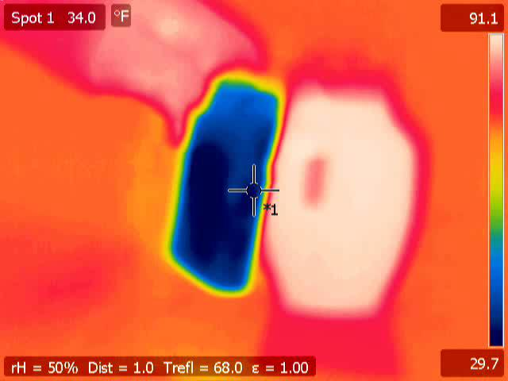 `thermal-warm-water-carafe-level-01.jpg` | Warm water carafe next to an ice block; the warm water shows where the liquid is, and the ice is reflected on the glass (a reflection pitfall). | Thermal (LWIR) | Alex and Jarek Tuszyński | CC BY-SA 3.0 | Alex and Jarek Tuszyński, CC BY-SA 3.0, via Wikimedia Commons | [File page](https://commons.wikimedia.org/wiki/File:Thermal_image_-_face_-_Ice_block_and_warm_water_carafe.jpg), [direct file](https://upload.wikimedia.org/wikipedia/commons/0/05/Thermal_image_-_face_-_Ice_block_and_warm_water_carafe.jpg) |
| 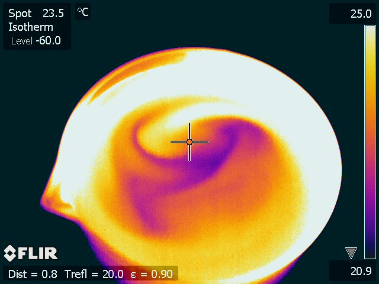 `thermal-glass-of-water-01.jpg` | Glass of water (FLIR SC640); the liquid and the glass above it read at different temperatures. | Thermal (LWIR) | Eclipse.sx | CC BY-SA 3.0 | Eclipse.sx, CC BY-SA 3.0, via Wikimedia Commons | [File page](https://commons.wikimedia.org/wiki/File:IRWater.jpg), [direct file](https://upload.wikimedia.org/wikipedia/commons/c/cb/IRWater.jpg) |

## 3. Thermal images of motors, pumps, and electrical equipment

| Image | What it shows | IR type | Author | License | Attribution text | Source |
|---|---|---|---|---|---|---|
| 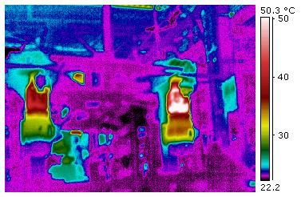 `thermal-motor-wrong-bearings-01.jpg` | Industrial motor installed vertically though built for horizontal mounting; the bearing end runs hot. A good "failing rotating equipment" example. | Thermal (LWIR) | Hotflashhome | CC BY-SA 3.0 | Hotflashhome, CC BY-SA 3.0, via Wikimedia Commons | [File page](https://commons.wikimedia.org/wiki/File:Horizontal_motor.jpg), [direct file](https://upload.wikimedia.org/wikipedia/commons/d/d6/Horizontal_motor.jpg) |
| 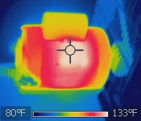 `thermal-electric-motor-01.jpg` | Running electric motor showing heat loss (FLIR i7, low resolution). Shows what a normal warm motor looks like. | Thermal (LWIR) | Zaereth | CC0 | Zaereth, CC0 (attribution not required), via Wikimedia Commons | [File page](https://commons.wikimedia.org/wiki/File:Electric_motor_thermal_image.jpg), [direct file](https://upload.wikimedia.org/wikipedia/commons/a/a3/Electric_motor_thermal_image.jpg) |
| 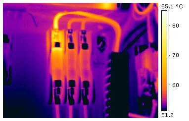 `thermal-fuse-block-fault-01.jpg` | Industrial fuse block with one hot fuse (bright yellow) next to normal ones. | Thermal (LWIR) | Hotflashhome | CC BY-SA 3.0 | Hotflashhome, CC BY-SA 3.0, via Wikimedia Commons | [File page](https://commons.wikimedia.org/wiki/File:Electrical_fault.jpg), [direct file](https://upload.wikimedia.org/wikipedia/commons/1/1d/Electrical_fault.jpg) |
| 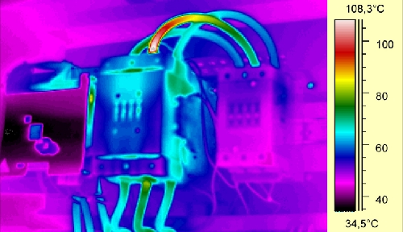 `thermal-contactor-bad-connection-01.jpg` | Electrical contactor with a defective cable connection glowing red to white, next to normally warm parts. | Thermal (LWIR) | Sönke Krüll | CC BY 3.0 | Sönke Krüll, CC BY 3.0, via Wikimedia Commons | [File page](https://commons.wikimedia.org/wiki/File:Elektroschuetz.jpg), [direct file](https://upload.wikimedia.org/wikipedia/commons/4/46/Elektroschuetz.jpg) |
| 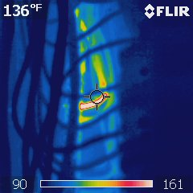 `thermal-neutral-bus-hot-spot-01.jpg` | Excessively hot spot (about 200 deg) on a panel neutral bus found in an inspection, 240x240 image. | Thermal (LWIR) | Basicinfrared | CC0 | Basicinfrared, CC0 (attribution not required), via Wikimedia Commons | [File page](https://commons.wikimedia.org/wiki/File:200_deg_neutral.jpg), [direct file](https://upload.wikimedia.org/wikipedia/commons/f/ff/200_deg_neutral.jpg) |
| 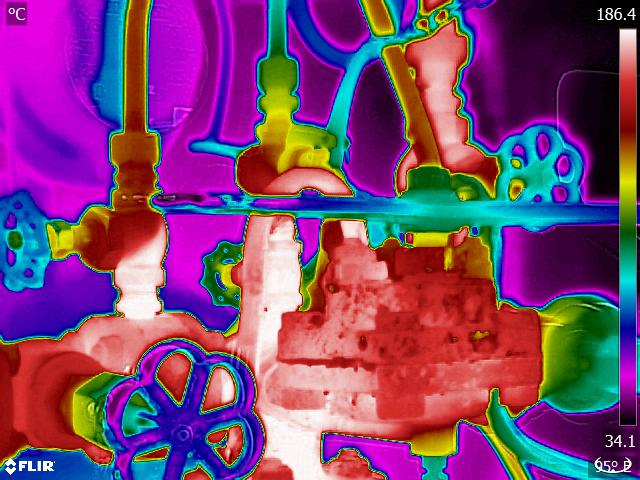 `thermal-steam-valves-pipework-01.jpg` | Steam locomotive footplate valves and pipework; hot lines stand out white on black. Shows how valves and pipes look in grayscale thermal. | Thermal (LWIR) | Christopher A.S. Harvey; Director of Leak Heat | CC BY-SA 4.0 | Christopher A.S. Harvey; Director of Leak Heat, CC BY-SA 4.0, via Wikimedia Commons | [File page](https://commons.wikimedia.org/wiki/File:Steam_Train_Valves_Thermal_Image.jpg), [direct file](https://upload.wikimedia.org/wikipedia/commons/b/bf/Steam_Train_Valves_Thermal_Image.jpg) |

## 4. Near-infrared and night-vision images

| Image | What it shows | IR type | Author | License | Attribution text | Source |
|---|---|---|---|---|---|---|
| 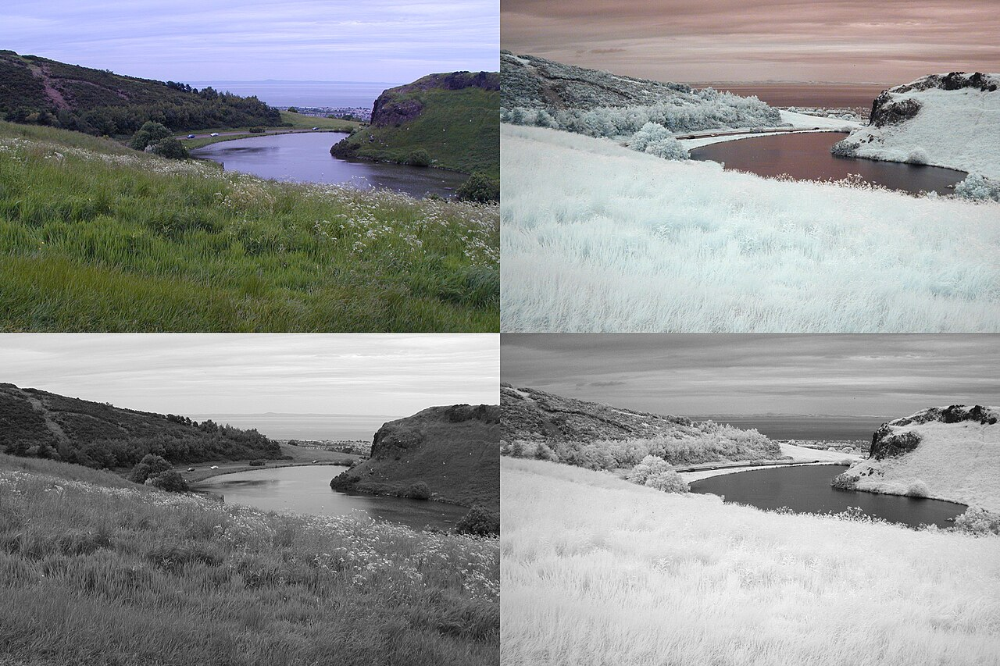 `nir-vs-visible-loch-water-01.jpg` | Same lake photographed in visible light and through a 720 nm IR filter, color and mono; in near-infrared, water typically turns dark and plants turn bright. | Near-infrared (720 nm+) vs visible | Yottanesia | CC BY-SA 3.0 | Yottanesia, CC BY-SA 3.0, via Wikimedia Commons | [File page](https://commons.wikimedia.org/wiki/File:Dunsapie_Loch_visible_and_infrared_comparison_colour_and_mono.jpg), [direct file](https://thumb.wikimedia.org/wikipedia/commons/thumb/2/21/Dunsapie_Loch_visible_and_infrared_comparison_colour_and_mono.jpg/1280px-Dunsapie_Loch_visible_and_infrared_comparison_colour_and_mono.jpg) |
| 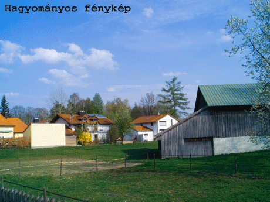 `nir-720-850-950nm-filter-comparison-01.gif` | Animated comparison of one scene through 720, 850 and 950 nm filters, the same band as the NoIR camera and its LEDs. | Near-infrared | Szalipszki Gábor (Szalipszki at Hungarian Wikipedia) | CC BY-SA 3.0 | Szalipszki Gábor (Szalipszki at Hungarian Wikipedia), CC BY-SA 3.0, via Wikimedia Commons | [File page](https://commons.wikimedia.org/wiki/File:720,_850_%C3%A9s_950nm-es_infrasz%C5%B1r%C5%91k_%C3%B6sszehasonl%C3%ADt%C3%A1sa.gif), [direct file](https://upload.wikimedia.org/wikipedia/commons/e/ea/720%2C_850_%C3%A9s_950nm-es_infrasz%C5%B1r%C5%91k_%C3%B6sszehasonl%C3%ADt%C3%A1sa.gif) |
| 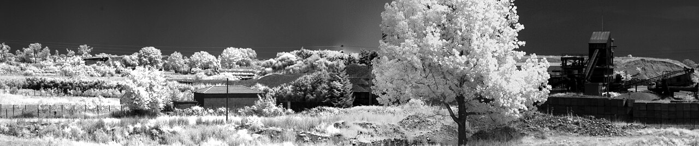 `nir-1000nm-landscape-01.jpg` | Wide landscape photographed at 1000 nm, showing the monochrome near-infrared look of buildings and vegetation. | Near-infrared | George Pavlidis | CC BY-SA 4.0 | George Pavlidis, CC BY-SA 4.0, via Wikimedia Commons | [File page](https://commons.wikimedia.org/wiki/File:1000nm-IR-landscape-from-the-office.jpg), [direct file](https://thumb.wikimedia.org/wikipedia/commons/thumb/4/4e/1000nm-IR-landscape-from-the-office.jpg/1280px-1000nm-IR-landscape-from-the-office.jpg) |
| 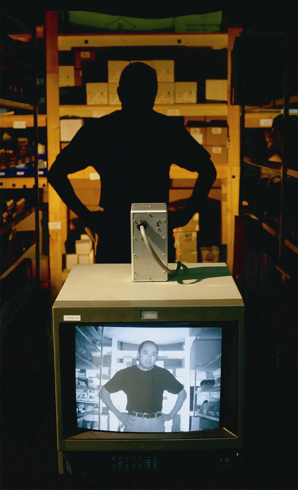 `nir-cctv-active-ir-night-01.jpg` | Security camera image in total darkness lit by an active IR illuminator, the exact setup of the NoIR camera with IR LEDs. | Near-infrared (active illumination) | Extreme CCTV | Attribution | Extreme CCTV (www.ExtremeCCTV.com), via Wikimedia Commons | [File page](https://commons.wikimedia.org/wiki/File:Active-Infrared-Night-Vision.jpg), [direct file](https://upload.wikimedia.org/wikipedia/commons/4/41/Active-Infrared-Night-Vision.jpg) |
| 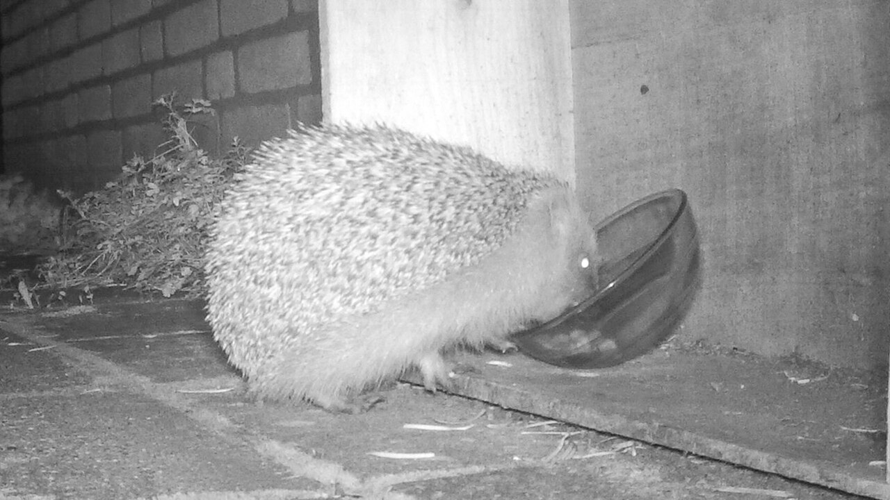 `nir-camera-trap-night-01.jpg` | Hedgehog at night from a wildlife camera trap (these use an IR flash); a typical grayscale night image of the kind the NoIR camera makes. | Near-infrared (active illumination) | Alex P. Kok | CC BY-SA 4.0 | Alex P. Kok, CC BY-SA 4.0, via Wikimedia Commons | [File page](https://commons.wikimedia.org/wiki/File:Hedgehog_at_night_taken_with_camera_trap.jpg), [direct file](https://thumb.wikimedia.org/wikipedia/commons/thumb/5/5d/Hedgehog_at_night_taken_with_camera_trap.jpg/1280px-Hedgehog_at_night_taken_with_camera_trap.jpg) |

## 5. Side-by-side visible and thermal comparisons

| Image | What it shows | IR type | Author | License | Attribution text | Source |
|---|---|---|---|---|---|---|
| 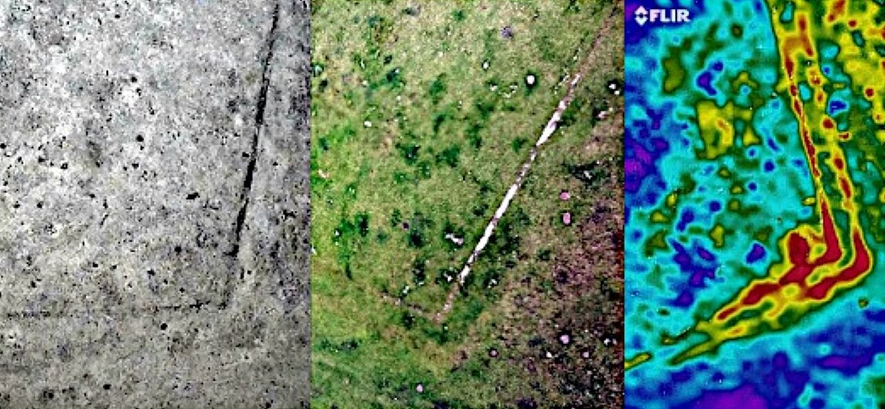 `compare-nir-visible-thermal-aerial-01.jpg` | Kite aerial view of old reservoir wall foundations in near-infrared, visible and thermal, side by side. The best single image for explaining the three bands. | Near-infrared, visible, and thermal | Dr John Wells | CC BY 4.0 | Dr John Wells, CC BY 4.0, via Wikimedia Commons | [File page](https://commons.wikimedia.org/wiki/File:The_residual_foundations_of_a_double-walled_enclosure_in_the_near_infrared,_visible_spectrum_and_thermal_infrared.jpg), [direct file](https://thumb.wikimedia.org/wikipedia/commons/thumb/1/18/The_residual_foundations_of_a_double-walled_enclosure_in_the_near_infrared%2C_visible_spectrum_and_thermal_infrared.jpg/1280px-The_residual_foundations_of_a_double-walled_enclosure_in_the_near_infrared%2C_visible_spectrum_and_thermal_infrared.jpg) |
| 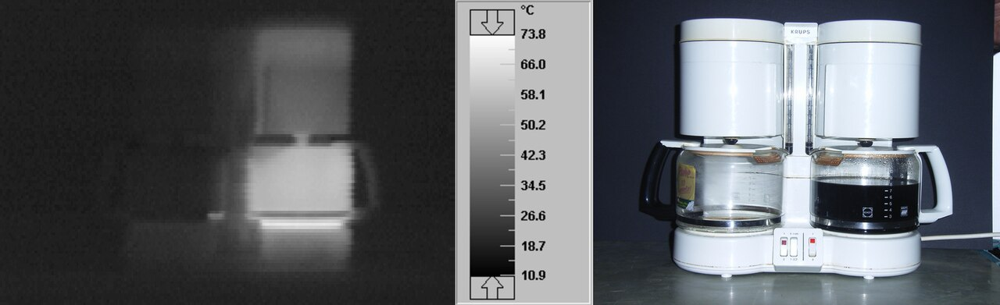 `compare-visible-thermal-coffee-maker-01.jpg` | Coffee maker in thermal (left) and visible (right); the hot water reservoir and hot plate light up. | Thermal (LWIR) vs visible | Torsten Henning | Public domain | Torsten Henning, Public domain (attribution not required), via Wikimedia Commons | [File page](https://commons.wikimedia.org/wiki/File:CoffeeBrewerThermography_ty_20060920i1col0.jpg), [direct file](https://thumb.wikimedia.org/wikipedia/commons/thumb/9/96/CoffeeBrewerThermography_ty_20060920i1col0.jpg/1280px-CoffeeBrewerThermography_ty_20060920i1col0.jpg) |
| 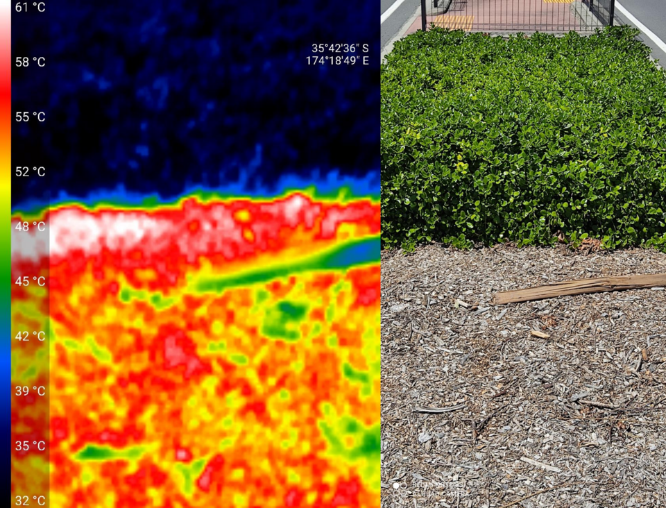 `compare-visible-thermal-ground-01.png` | Traffic median in thermal and visible; mulch at 61 C versus plants at 32 C, showing how sun-heated ground can dominate a thermal scene. | Thermal (LWIR) vs visible | PeterBruce-Iri | CC BY-SA 4.0 | PeterBruce-Iri, CC BY-SA 4.0, via Wikimedia Commons | [File page](https://commons.wikimedia.org/wiki/File:Thermal_and_visual_image_showing_29_degree_C._temperature_differential.png), [direct file](https://thumb.wikimedia.org/wikipedia/commons/thumb/8/87/Thermal_and_visual_image_showing_29_degree_C._temperature_differential.png/960px-Thermal_and_visual_image_showing_29_degree_C._temperature_differential.png) |
| 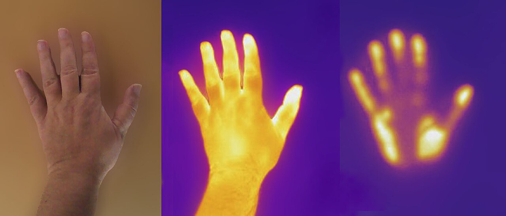 `compare-visible-thermal-hand-print-01.jpg` | Hand in visible and thermal, then the heat print left on the surface after the hand is removed. | Thermal (LWIR) vs visible | Amfeli | CC BY 4.0 | Amfeli, CC BY 4.0, via Wikimedia Commons | [File page](https://commons.wikimedia.org/wiki/File:Mano_en_el_espectro_visible_y_en_el_infrarrojo_t%C3%A9rmico.jpg), [direct file](https://thumb.wikimedia.org/wikipedia/commons/thumb/c/c6/Mano_en_el_espectro_visible_y_en_el_infrarrojo_t%C3%A9rmico.jpg/1280px-Mano_en_el_espectro_visible_y_en_el_infrarrojo_t%C3%A9rmico.jpg) |
| 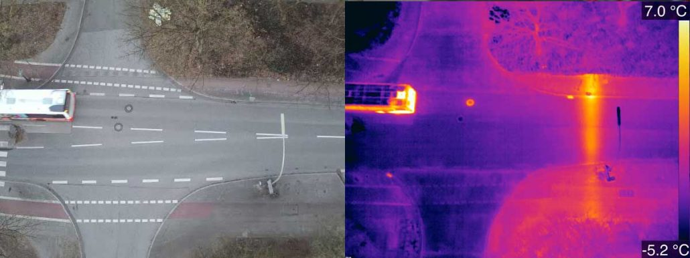 `compare-visible-thermal-drone-road-01.jpg` | Drone inspection of a road, thermal camera next to the normal camera. | Thermal (LWIR) vs visible | Coptercloud | CC BY-SA 4.0 | Coptercloud, CC BY-SA 4.0, via Wikimedia Commons | [File page](https://commons.wikimedia.org/wiki/File:Luftaufnahme_Inspektion_W%C3%A4rmebild.jpg), [direct file](https://upload.wikimedia.org/wikipedia/commons/6/69/Luftaufnahme_Inspektion_W%C3%A4rmebild.jpg) |

## 6. What a low-resolution thermal sensor sees

No openly licensed MLX90640 or AMG8833 sample image was found on Commons.
These are the lowest-resolution openly licensed examples found.
The MLX90640 (32x24) and AMG8833 (8x8) are lower resolution than all of them, so the team's frames will be even blockier.
See "Links only" for vendor samples from those sensors.

| Image | What it shows | IR type | Author | License | Attribution text | Source |
|---|---|---|---|---|---|---|
| 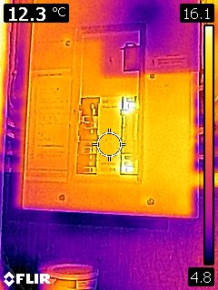 `lowres-80x60-flir-c2-breakers-01.jpg` | Breaker panel with two warm AFCI breakers, from a FLIR C2 (80x60 thermal sensor, upscaled). Close to what an MLX90640 (32x24) or Lepton (80x60) shows. | Thermal (LWIR), low resolution | Tenbergen | CC BY-SA 4.0 | Tenbergen, CC BY-SA 4.0, via Wikimedia Commons | [File page](https://commons.wikimedia.org/wiki/File:AFCIs_Infrared.jpg), [direct file](https://upload.wikimedia.org/wikipedia/commons/6/69/AFCIs_Infrared.jpg) |
| 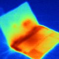 `lowres-120x120-laptop-01.jpg` | Laptop thermal image at 120x120 pixels from an Infrared Solutions IR SnapShot; shows how blocky a low-resolution frame is. | Thermal (LWIR), low resolution | Moki8 | CC BY-SA 4.0 | Moki8, CC BY-SA 4.0, via Wikimedia Commons | [File page](https://commons.wikimedia.org/wiki/File:Dell_XPS_14_Infrared_Solutions_IR_SnapShot.jpg), [direct file](https://upload.wikimedia.org/wikipedia/commons/8/88/Dell_XPS_14_Infrared_Solutions_IR_SnapShot.jpg) |
| 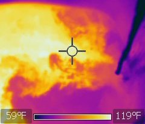 `lowres-flir-i7-hot-cold-water-sink-01.jpg` | Sink of hot water with cold water being added; the two layers stay separate. FLIR i7 (low-resolution entry camera). | Thermal (LWIR), low resolution | Zaereth | CC0 | Zaereth, CC0 (attribution not required), via Wikimedia Commons | [File page](https://commons.wikimedia.org/wiki/File:Hot_and_cold_water_immiscibility_thermal_image.jpg), [direct file](https://upload.wikimedia.org/wikipedia/commons/4/4b/Hot_and_cold_water_immiscibility_thermal_image.jpg) |
| 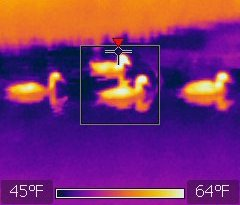 `lowres-flir-i7-ducks-on-water-01.jpg` | Four ducks on a pond; per the author, the water surface reflects infrared strongly, so water can mirror the sky and read colder than it is. | Thermal (LWIR), low resolution | Zaereth | CC0 | Zaereth, CC0 (attribution not required), via Wikimedia Commons | [File page](https://commons.wikimedia.org/wiki/File:Thermal_image_of_four_ducks_swimming.jpg), [direct file](https://upload.wikimedia.org/wikipedia/commons/e/e5/Thermal_image_of_four_ducks_swimming.jpg) |

## Links only (not downloaded)

These pages have useful images but no open license, so they were not downloaded.
Open them in a browser to view.

- Adafruit MLX90640 guide, with sample 32x24 thermal frames: https://learn.adafruit.com/adafruit-mlx90640-ir-thermal-camera
- Adafruit AMG8833 guide, with sample 8x8 thermal frames: https://learn.adafruit.com/adafruit-amg8833-8x8-thermal-camera-sensor
- SparkFun Grid-EYE (AMG88xx) hookup guide, with 8x8 example output: https://learn.sparkfun.com/tutorials/qwiic-grid-eye-infrared-array-amg88xx-hookup-guide
- Pimoroni MLX90640 breakout product page, with example images: https://shop.pimoroni.com/products/mlx90640-thermal-camera-breakout
- GroupGets PureThermal 2 (FLIR Lepton 80x60 and 160x120 board), with example images: https://groupgets.com/products/purethermal-2-flir-lepton-smart-i-o-module
- US EPA ASPECT airborne infrared program page (source of the oil-burn image): https://www.epa.gov/emergency-response/aspect

## Gaps

- Roof moisture surveys: no openly licensed thermal roof moisture image was found; the Commons roof images show roof coatings, not wet insulation.
- Leaks inside walls or floors: no true leak image was found; the floor-heating pipe image is the closest analog.
- Buried water main leaks seen from above: none found.
- Tank liquid level on a real storage tank: none found, only kettle, carafe and glass analogs.
- Pump images: no openly licensed thermal image of a centrifugal or transfer pump was found; motors and electrical gear stand in.
- Near-infrared images of puddles or wet pavement at night: none found; the lake comparisons show the same "water looks dark" effect in daylight.
- MLX90640 and AMG8833 sample frames: none openly licensed; see the links above.
- Optical gas imaging of methane or VOC leaks: no openly licensed example was found.
- The downloaded files were checked with `file` only and were not viewed, so the descriptions come from the authors' captions on Commons.
