# Water leak and water infrastructure reference images

Reference photos for the HackUTD 2026 EOG produced water project: leaks, tanks, pumps, trucks, leak detection, and saltwater disposal.
They are for the app, the pitch deck, and the physical mock that the robot drives to.
Every image is water or brine only, with no crude oil, pumpjacks, or oil wellheads (one injection wellhead is flagged below).
All files come from Wikimedia Commons or US federal agencies (USGS, FEMA, GAO, US Navy), and each license was checked on the file page.
Files are scaled to about 1280 px wide or smaller.

## Attribution

CC BY and CC BY-SA images need attribution wherever they are used, such as on the slide, in the app credits, or in the demo video credits.
Use the text in the Attribution text column and link the license where possible.
CC BY-SA also means that an edited version of the image must be shared under the same license.
Public domain and CC0 images need no attribution, but crediting the source is still good practice.

## 1. Water pipeline leaks and breaks

| Image | What it shows | Author | License | Attribution text | Source |
| --- | --- | --- | --- | --- | --- |
| 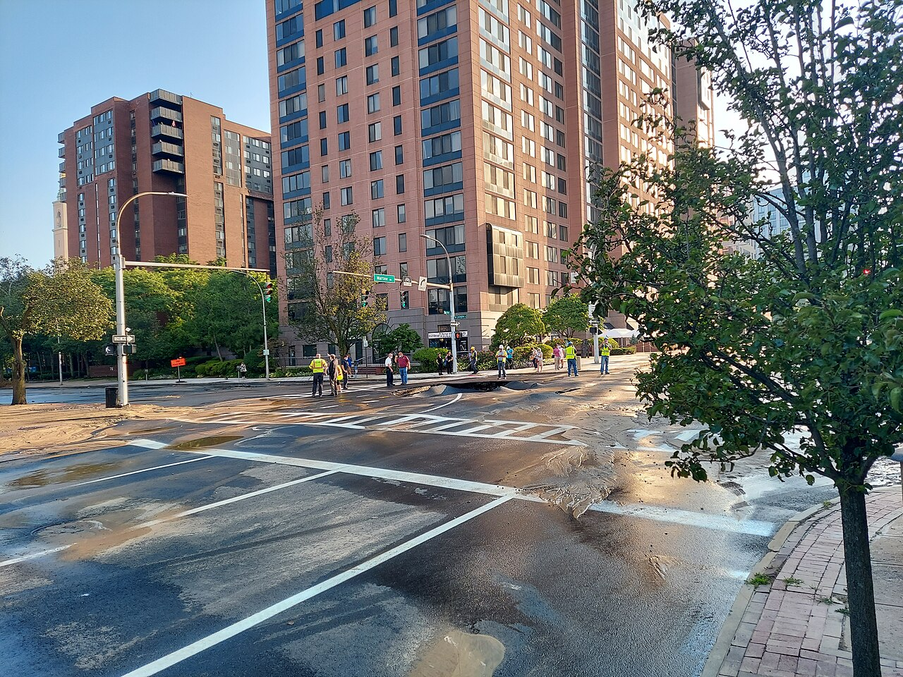 `water-main-break-01.jpg` | Street intersection flooded right after a water main break, White Plains, New York, 2020. | SVTCobra | CC BY-SA 4.0 | SVTCobra / Wikimedia Commons, CC BY-SA 4.0 | [file page](https://commons.wikimedia.org/wiki/File:2020_White_Plains_Water_Main_Break_20200810_(1).jpg) |
| 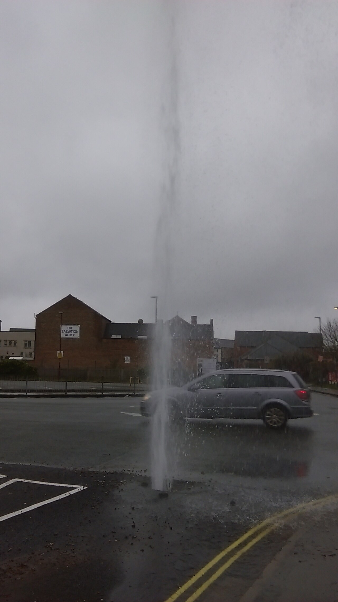 `burst-pipe-street-01.jpg` | Water erupting from a burst pipe under a street, Long Eaton, UK, within 30 minutes of the break. | Crep171166 | CC BY-SA 4.0 | Crep171166 / Wikimedia Commons, CC BY-SA 4.0 | [file page](https://commons.wikimedia.org/wiki/File:Burst_pipe_in_Long_Eaton.jpg) |
| 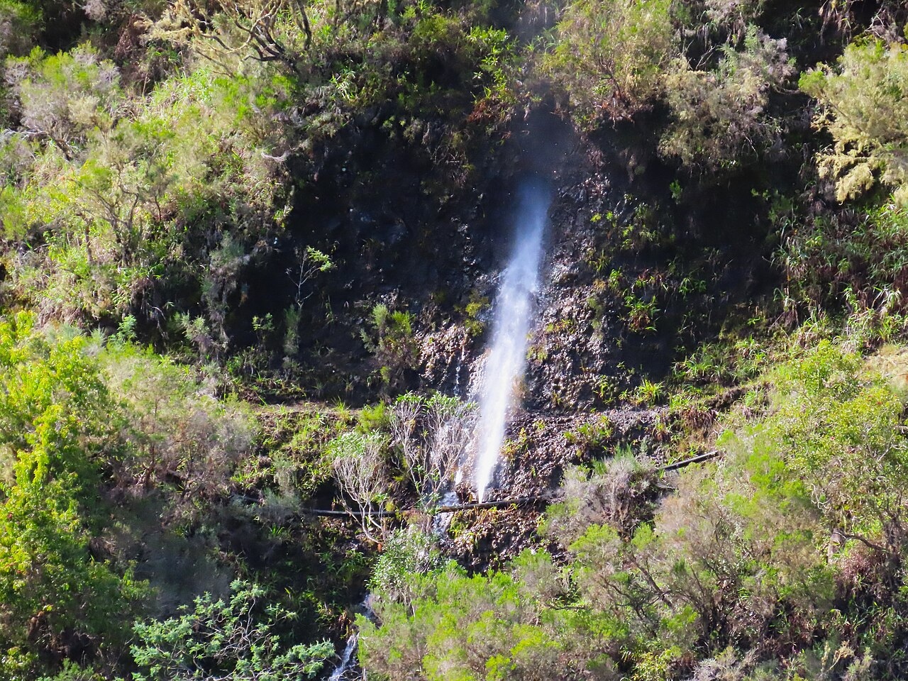 `pipeline-leak-spray-01.jpg` | Above-ground water pipeline leaking and spraying water, La Reunion, France. | Rémih | CC BY-SA 4.0 | Rémih / Wikimedia Commons, CC BY-SA 4.0 | [file page](https://commons.wikimedia.org/wiki/File:Water_pipeline_leak_@_Bord_de_Mars_01.jpg) |
| 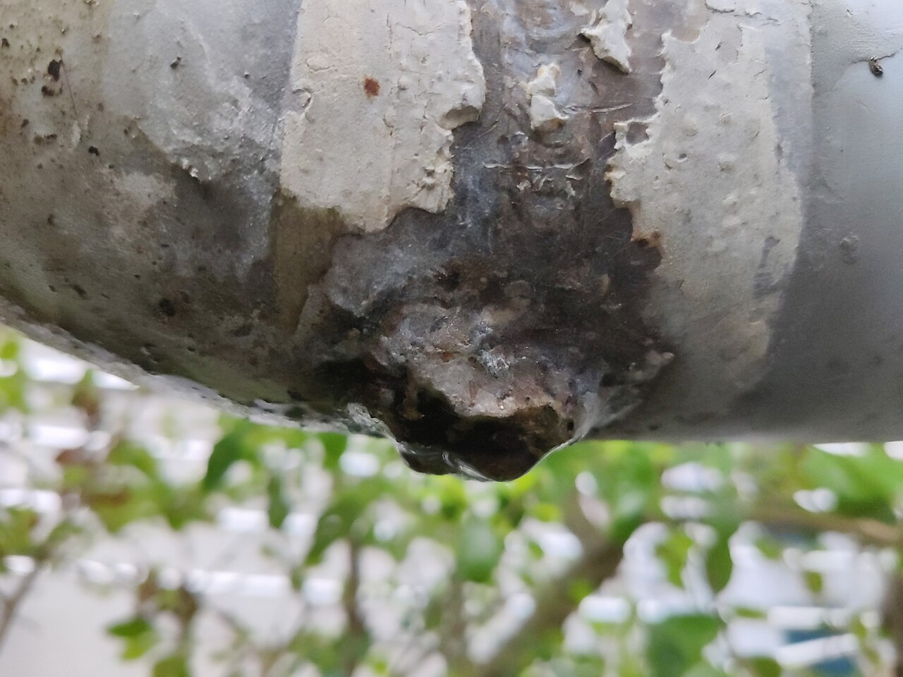 `pinhole-leak-rusted-pipe-01.jpg` | Small leak at a rusted spot on the bend of a well-water pipe, water dripping. Good close-up of a pinhole-type leak. | Shamrock Lee | CC BY 4.0 | Shamrock Lee / Wikimedia Commons, CC BY 4.0 | [file page](https://commons.wikimedia.org/wiki/File:Leak_in_rusted_pipe_side_view.jpg) |
| 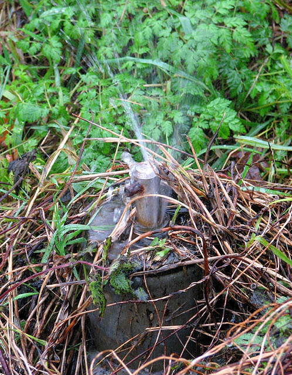 `leaking-pipe-spray-01.jpg` | Fine spray of water from a leaking pipe over plants at a field edge, Norfolk, UK. | Evelyn Simak | CC BY-SA 2.0 | Evelyn Simak / Wikimedia Commons, CC BY-SA 2.0 | [file page](https://commons.wikimedia.org/wiki/File:A_spray_of_water_-_geograph.org.uk_-_1062472.jpg) |
| 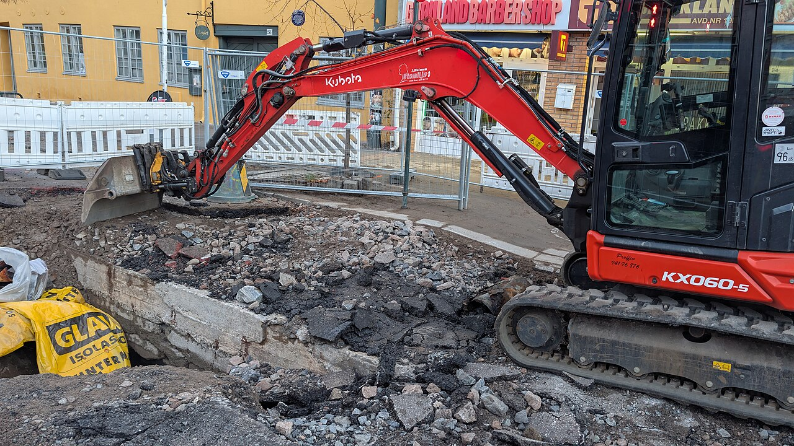 `street-water-leak-01.jpg` | Water leaking up through a city street surface at Gronland torg, Oslo, 2026 (a district heating hot water line). Shows water surfacing above a buried leak. | Premeditated | CC BY-SA 4.0 | Premeditated / Wikimedia Commons, CC BY-SA 4.0 | [file page](https://commons.wikimedia.org/wiki/File:Water_leakage_at_Gr%C3%B8nland_torg_in_2026.jpg) |

## 2. Produced water and brine spills

| Image | What it shows | Author | License | Attribution text | Source |
| --- | --- | --- | --- | --- | --- |
| 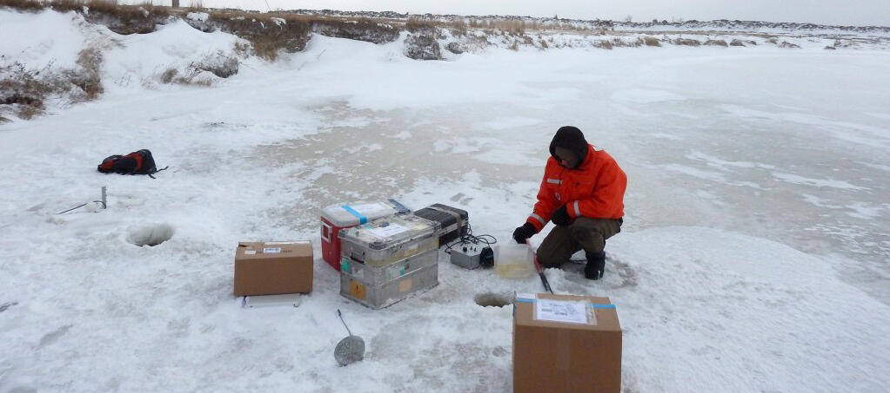 `brine-spill-sampling-01.jpg` | USGS scientist sampling a creek through ice after a 3 million gallon saltwater (brine) pipeline spill in western North Dakota, January 2015. | USGS, Reston Biogeochemical Processes in Groundwater Laboratory | Public domain (US federal work) | Photo: USGS, Reston Biogeochemical Processes in Groundwater Laboratory (public domain) | [file page](https://www.usgs.gov/media/images/sampling-hydraulic-fracturing-brine-waste-spill) |
| 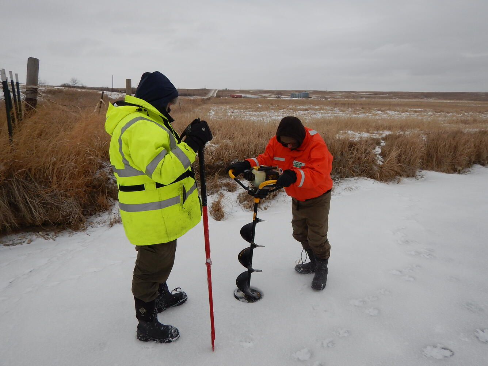 `brine-spill-winter-sampling-01.jpg` | Power ice auger used to sample streams after a large oil and gas brine wastewater spill into Missouri River tributaries, North Dakota. | USGS, Reston Biogeochemical Processes in Groundwater Laboratory | Public domain (US federal work) | Photo: USGS, Reston Biogeochemical Processes in Groundwater Laboratory (public domain) | [file page](https://www.usgs.gov/media/images/winter-sampling-after-unconventional-oil-and-gas-brine-spill) |
| 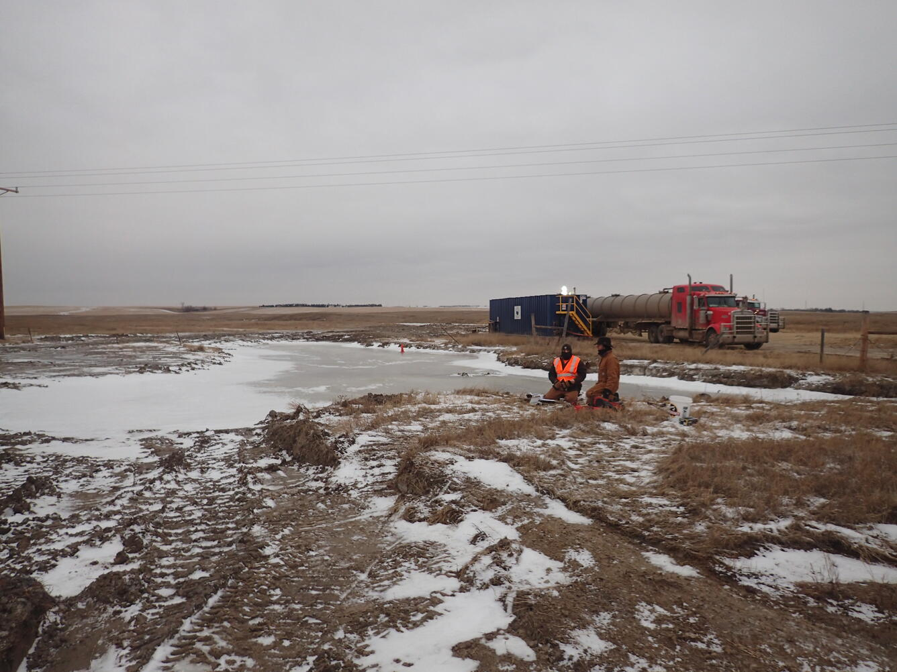 `brine-spill-site-measurements-01.jpg` | USGS scientists taking measurements at a produced water spill site, February 2015. | USGS, Water Resources Mission Area | Public domain (US federal work) | Photo: USGS, Water Resources Mission Area (public domain) | [file page](https://www.usgs.gov/media/images/usgs-scientists-conduct-measurements-a-oil-and-gas-produced-waters) |
| 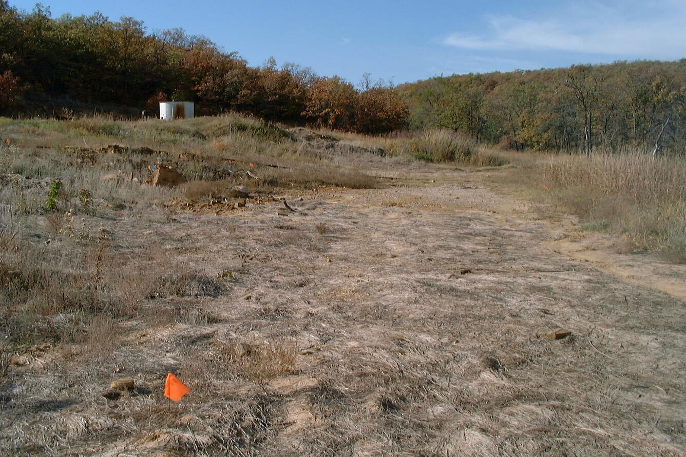 `salt-scar-produced-water-01.jpg` | Salt scar (bare, salt-killed ground) near Skiatook Lake, Oklahoma, caused by a produced water spill, 2001. | USGS, Environmental Health Program | Public domain (US federal work) | Photo: USGS, Environmental Health Program (public domain) | [file page](https://www.usgs.gov/media/images/salt-scar-near-lake-skiatook-ok-caused-produced-water-spill) |
| 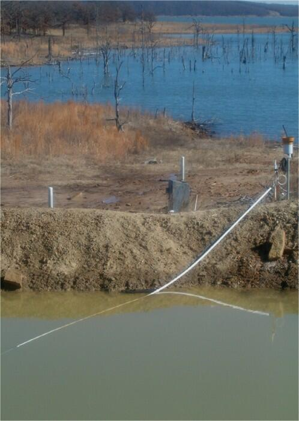 `salt-scar-monitoring-01.jpg` | Salt scar running from an old brine pit toward Skiatook Lake, with USGS monitoring wells and sampling equipment installed on it. | USGS, Environmental Health Program | Public domain (US federal work) | Photo: USGS, Environmental Health Program (public domain) | [file page](https://www.usgs.gov/media/images/salt-scar-skiatook-lake-oklahoma) |

## 3. Water storage tanks, overflow, and leaks

| Image | What it shows | Author | License | Attribution text | Source |
| --- | --- | --- | --- | --- | --- |
| 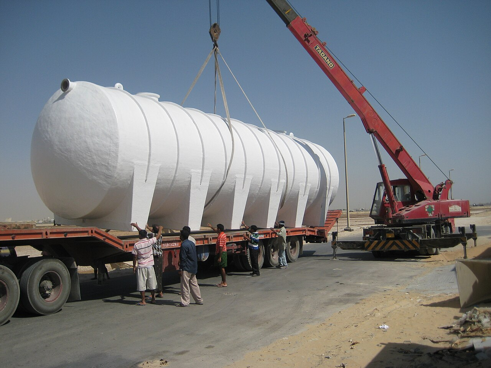 `fiberglass-water-tank-01.jpg` | Above-ground horizontal fiberglass (GRP) water storage tank. | world quality fiberglass | CC BY-SA 4.0 | world quality fiberglass / Wikimedia Commons, CC BY-SA 4.0 | [file page](https://commons.wikimedia.org/wiki/File:GRP_TANK.jpg) |
| 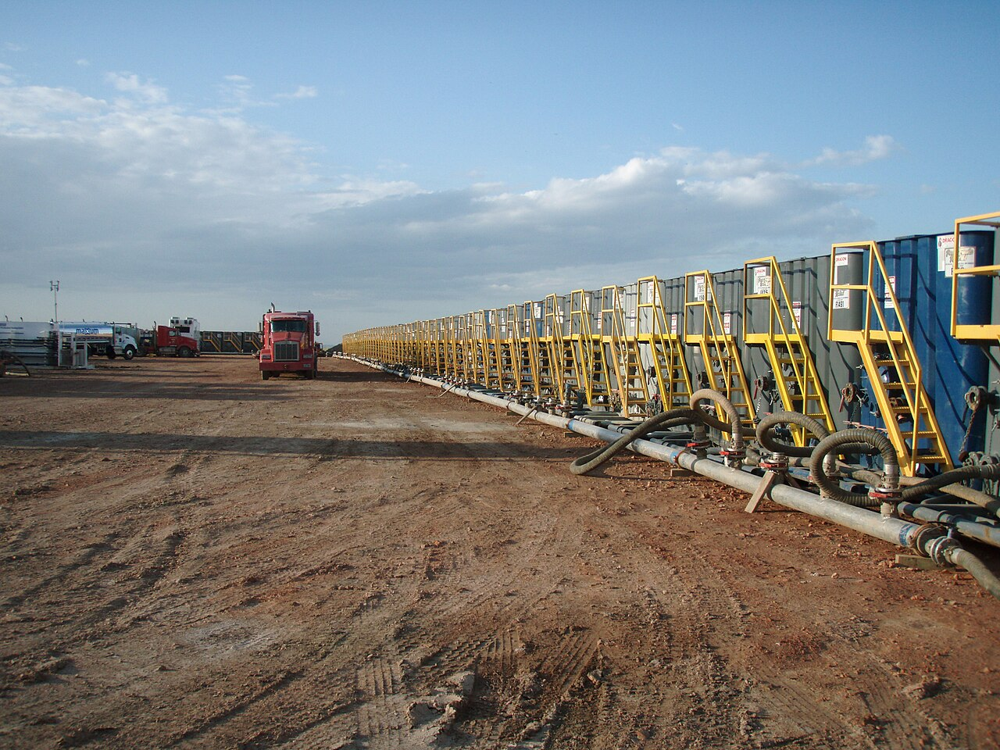 `frac-water-tanks-01.jpg` | Row of steel frac tanks holding water on an oilfield pad before a frac job. Closest match to oilfield water storage. | Joshua Doubek | CC BY-SA 3.0 | Joshua Doubek / Wikimedia Commons, CC BY-SA 3.0 | [file page](https://commons.wikimedia.org/wiki/File:Water_tanks_preparing_for_a_frac_job.JPG) |
| 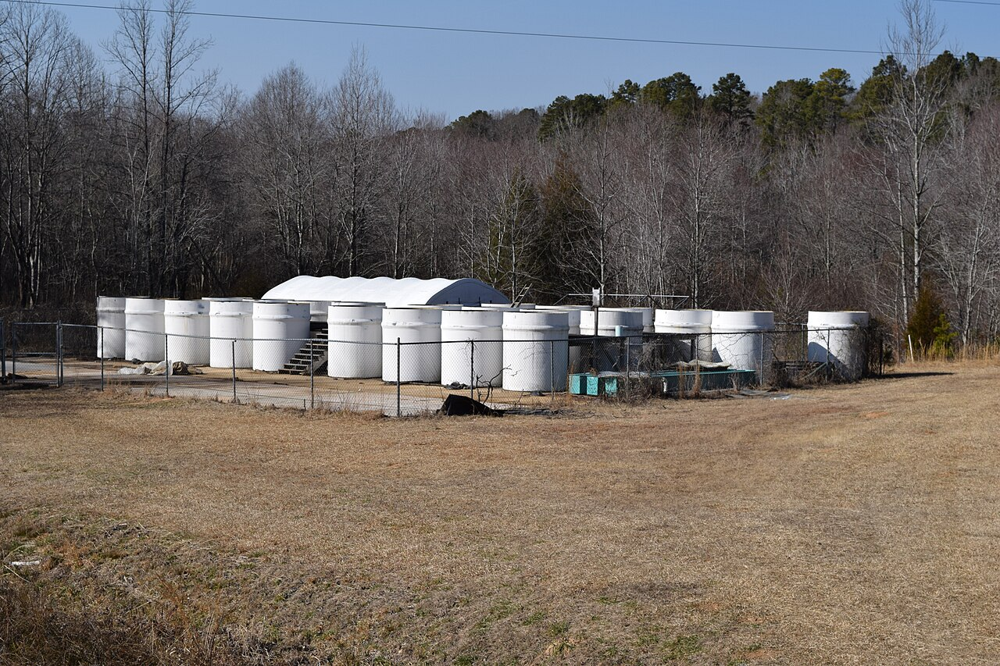 `fiberglass-tanks-02.jpg` | Large upright fiberglass tanks at a university field station. | Fredlyfish4 | CC BY-SA 4.0 | Fredlyfish4 / Wikimedia Commons, CC BY-SA 4.0 | [file page](https://commons.wikimedia.org/wiki/File:UMFS_fiberglass_tanks.JPG) |
| 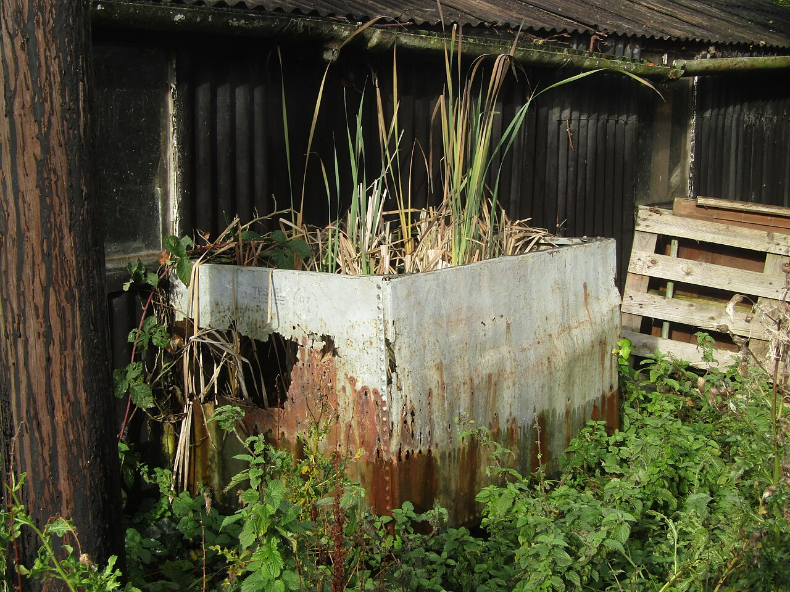 `rusting-water-tank-01.jpg` | Old steel rainwater tank slowly rusting, a reference for a corroded tank wall. | Kolforn | CC BY-SA 4.0 | Kolforn / Wikimedia Commons, CC BY-SA 4.0 | [file page](https://commons.wikimedia.org/wiki/File:-2019-11-05_A_rusting_rain_water_tank,_Loop_Road,_Trimingham.JPG) |
| 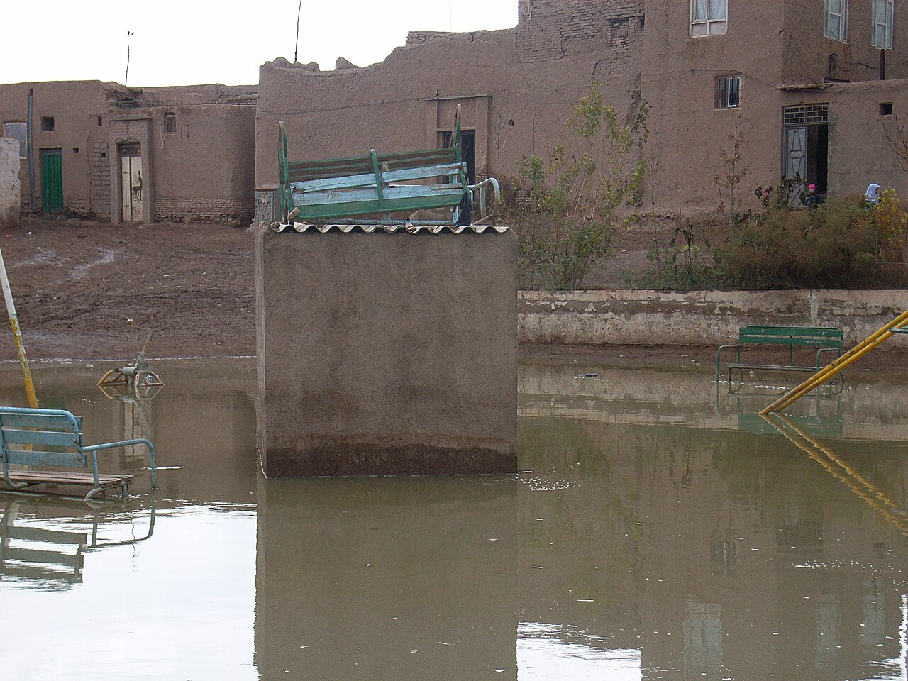 `tank-overflow-01.jpg` | Underground water storage tank overflowing and flooding the ground above it. | SuSanA Secretariat | CC BY 2.0 | SuSanA Secretariat / Wikimedia Commons, CC BY 2.0 | [file page](https://commons.wikimedia.org/wiki/File:Overflow_of_underground_greywater_collection_tank_(4361541139).jpg) |

## 4. Water transfer pumps and pump stations

| Image | What it shows | Author | License | Attribution text | Source |
| --- | --- | --- | --- | --- | --- |
| 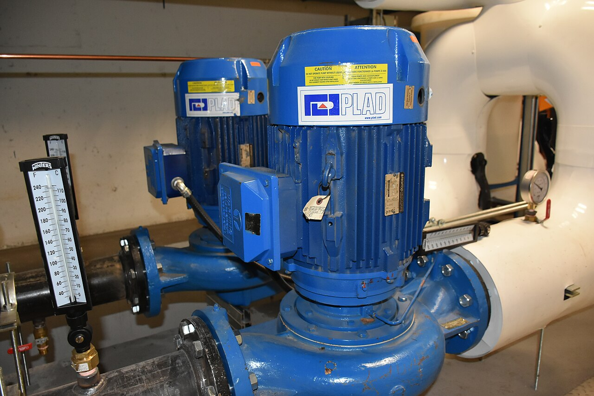 `centrifugal-pumps-01.jpg` | Pair of modern inline centrifugal pumps moving water in a building heating system. | Saud | CC BY-SA 4.0 | Saud / Wikimedia Commons, CC BY-SA 4.0 | [file page](https://commons.wikimedia.org/wiki/File:Centrifugal_Pump.jpg) |
| 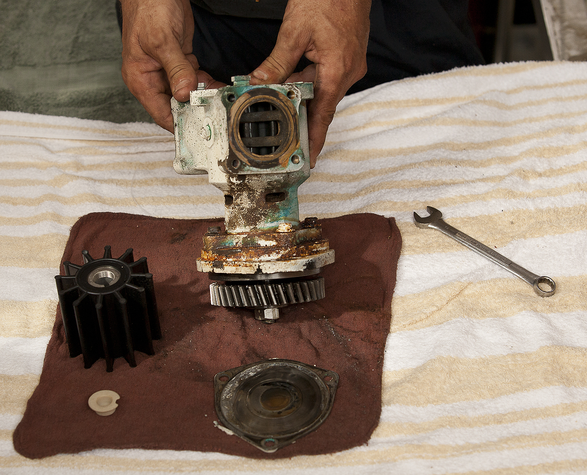 `leaking-pump-seal-01.jpg` | Failed engine raw water pump whose oil seal and raw water seal are both leaking, throwing off a slurry of water and oil. Reference for a leaking pump seal. | Captnshaw | CC BY-SA 3.0 | Captnshaw / Wikimedia Commons, CC BY-SA 3.0 | [file page](https://commons.wikimedia.org/wiki/File:Cummins_raw_water_pump_failure.jpg) |
| 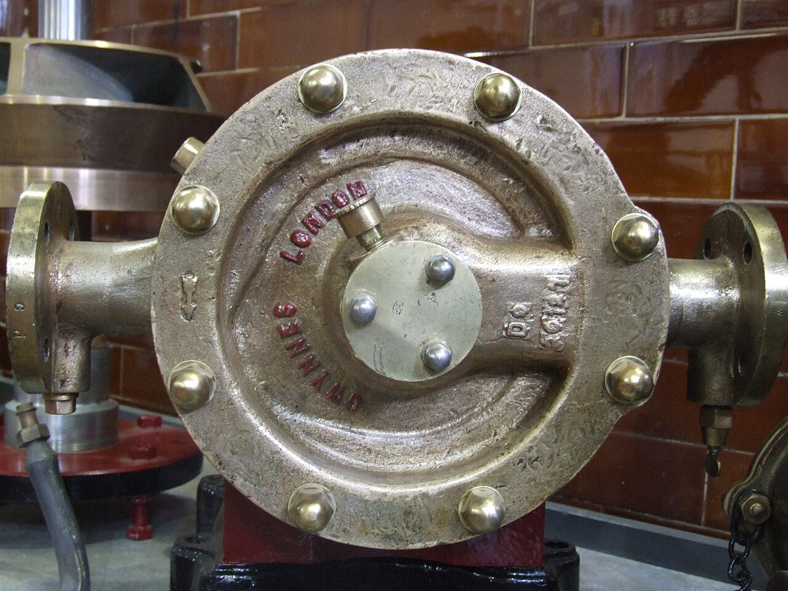 `centrifugal-pump-waterworks-01.jpg` | Large centrifugal water pump with its inlet piping, Brede Waterworks, UK. | Les Chatfield | CC BY 2.0 | Les Chatfield / Wikimedia Commons, CC BY 2.0 | [file page](https://commons.wikimedia.org/wiki/File:Gwynnes_centrifugal_pump_Brede_Waterworks.jpg) |
| 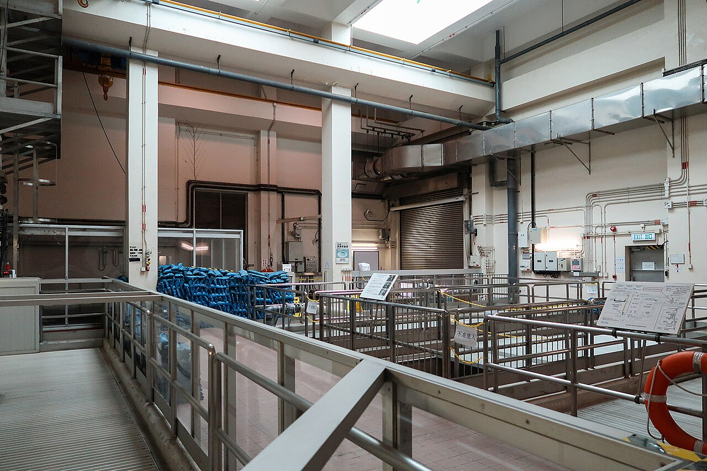 `pump-station-interior-01.jpg` | Interior of a modern water pumping station with large pumps and pipework, Hong Kong. | Wpcpey | CC BY-SA 4.0 | Wpcpey / Wikimedia Commons, CC BY-SA 4.0 | [file page](https://commons.wikimedia.org/wiki/File:Tai_Hang_Tung_Flood_Storage_Flood_water_pumping_station_interior_2018.jpg) |

## 5. Water trucks and vacuum trucks

| Image | What it shows | Author | License | Attribution text | Source |
| --- | --- | --- | --- | --- | --- |
| 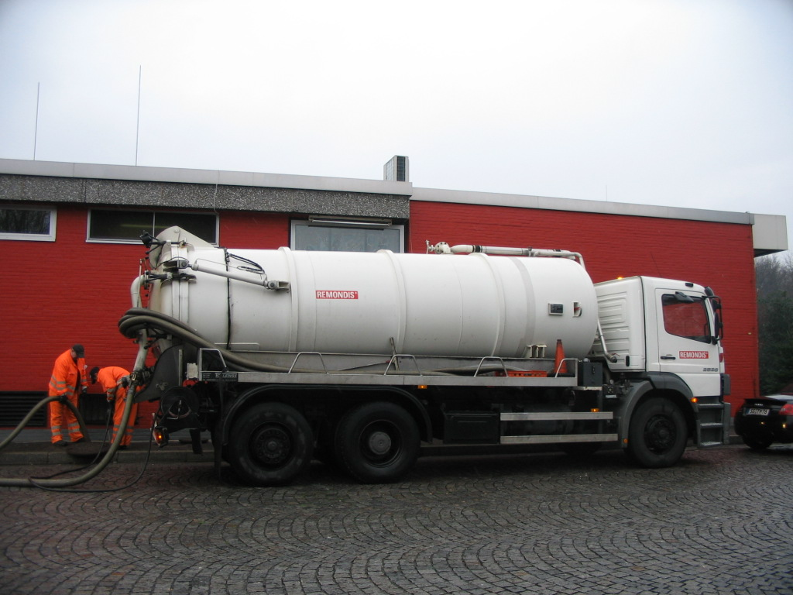 `vacuum-truck-01.jpg` | Vacuum tank truck with suction hose, Germany. | SuSanA Secretariat | CC BY 2.0 | SuSanA Secretariat / Wikimedia Commons, CC BY 2.0 | [file page](https://commons.wikimedia.org/wiki/File:Vacuum_truck_(2920675027).jpg) |
| 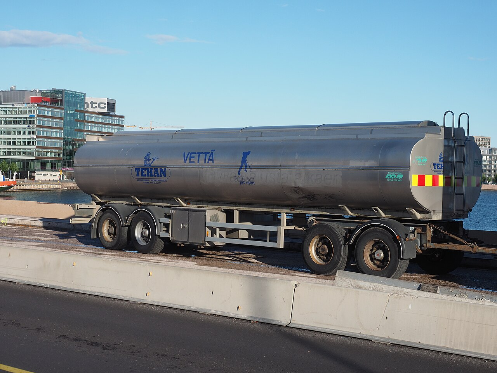 `water-tanker-truck-01.jpg` | Tanker truck hauling water on a bridge in Helsinki, Finland. | JIP | CC BY-SA 4.0 | JIP / Wikimedia Commons, CC BY-SA 4.0 | [file page](https://commons.wikimedia.org/wiki/File:Tanker_truck_full_of_water.jpg) |
| 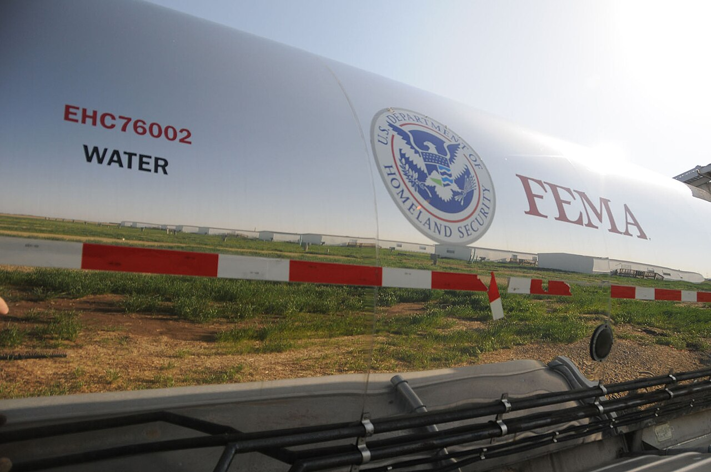 `water-tanker-truck-02.jpg` | FEMA water tanker truck in Greensburg, Kansas, 2008. | John Shea | Public domain | John Shea / Wikimedia Commons (Public domain, attribution not required) | [file page](https://commons.wikimedia.org/wiki/File:FEMA_-_35037_-_FEMA_water_tanker_truck_in_Kansas.jpg) |
| 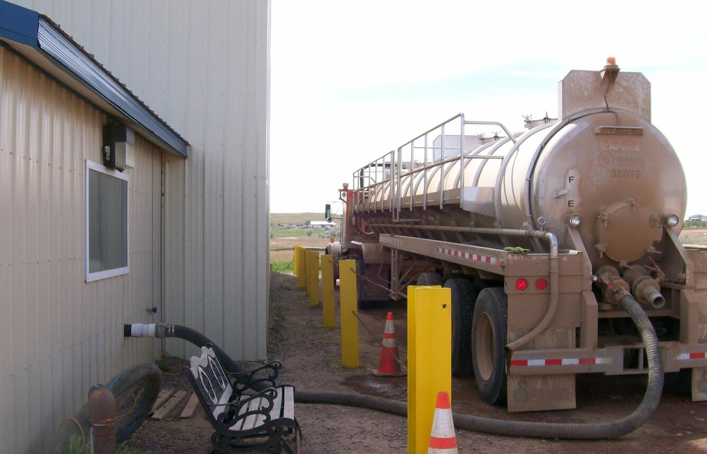 `water-depot-trucks-01.jpg` | Water depot near Watford, North Dakota, where water trucks fill up to supply oil and gas development. | Joanna Thamke, USGS | Public domain (US federal work) | Photo: Joanna Thamke, USGS (public domain) | [file page](https://www.usgs.gov/media/images/fig6ndsd) |

## 6. Leak detection work

| Image | What it shows | Author | License | Attribution text | Source |
| --- | --- | --- | --- | --- | --- |
| 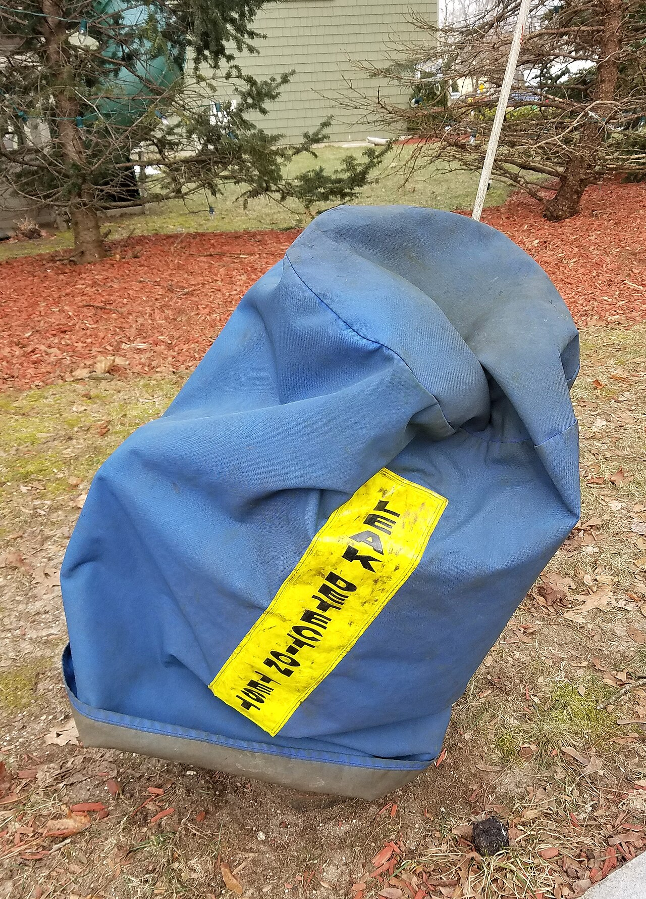 `leak-detection-hydrant-01.jpg` | Leak detection test being run at a fire hydrant on the water system, Arlington, Massachusetts. | Daderot | CC0 | Daderot / Wikimedia Commons (CC0, attribution not required) | [file page](https://commons.wikimedia.org/wiki/File:Leak_detection_test_for_fire_hydrant_-_Arlington,_MA.jpg) |
| 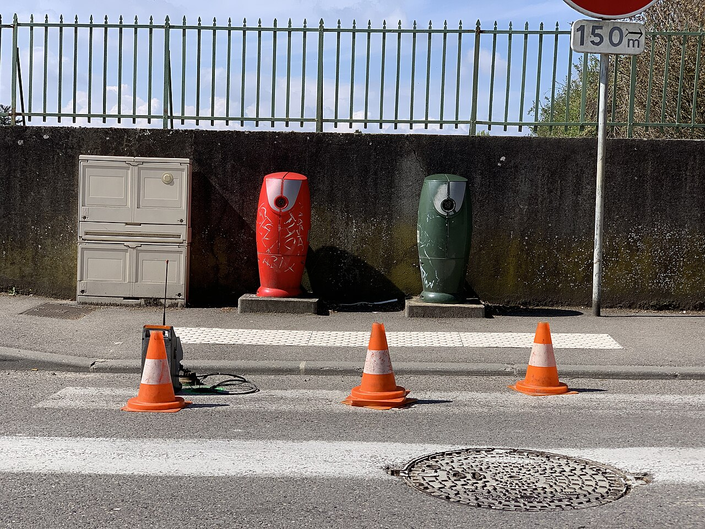 `leak-correlator-search-01.jpg` | Crew searching for a water main leak with an acoustic leak correlator (Hydreka MicroCorr) on a street, France. | Benoît Prieur | CC0 | Benoît Prieur / Wikimedia Commons (CC0, attribution not required) | [file page](https://commons.wikimedia.org/wiki/File:Recherche_d%27une_fuite_d%27eau_%C3%A0_l%27aide_d%27un_Hydreka_MicroCorr,_Mont%C3%A9e_de_la_Paroche_%C3%A0_Saint-Maurice-de-Beynost_(avril_2019).jpg) |
| 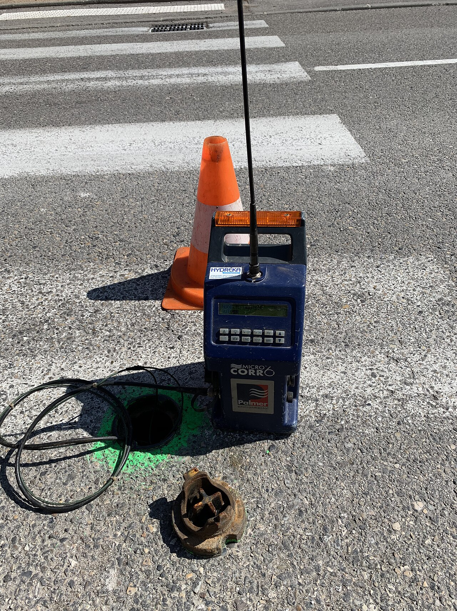 `leak-correlator-search-02.jpg` | Second view of the same acoustic leak correlator search on the street. | Benoît Prieur | CC0 | Benoît Prieur / Wikimedia Commons (CC0, attribution not required) | [file page](https://commons.wikimedia.org/wiki/File:Recherche_d%27une_fuite_d%27eau_%C3%A0_l%27aide_d%27un_Hydreka_MicroCorr,_Mont%C3%A9e_de_la_Paroche_%C3%A0_Saint-Maurice-de-Beynost_(avril_2019)_-_(2).jpg) |
| 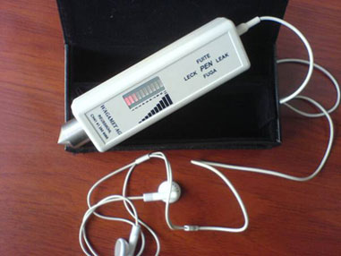 `ground-microphone-01.jpg` | Electronic ground microphone leak detector used to pinpoint buried water leaks by sound. Small image (381 px). | Dieter Altenburger | Public domain | Dieter Altenburger / Wikimedia Commons (Public domain, attribution not required) | [file page](https://commons.wikimedia.org/wiki/File:Geofonelight.jpg) |
| 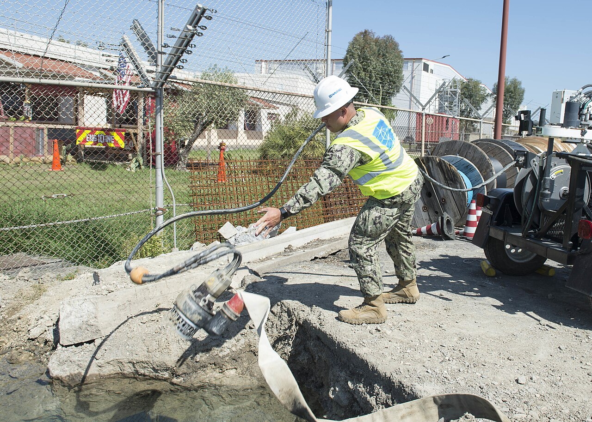 `inspecting-water-leak-01.jpg` | US Navy utilities worker inspecting a water leak, Naval Air Station Sigonella, Italy, 2022. | U.S. Navy photo by Petty Officer 2nd Class Josh Cote | Public domain | U.S. Navy photo by Petty Officer 2nd Class Josh Cote / Wikimedia Commons (Public domain, attribution not required) | [file page](https://commons.wikimedia.org/wiki/File:Sailor_Checks_On_Water_Leak_(7202820).jpg) |

## 7. Saltwater disposal and produced water treatment

| Image | What it shows | Author | License | Attribution text | Source |
| --- | --- | --- | --- | --- | --- |
| 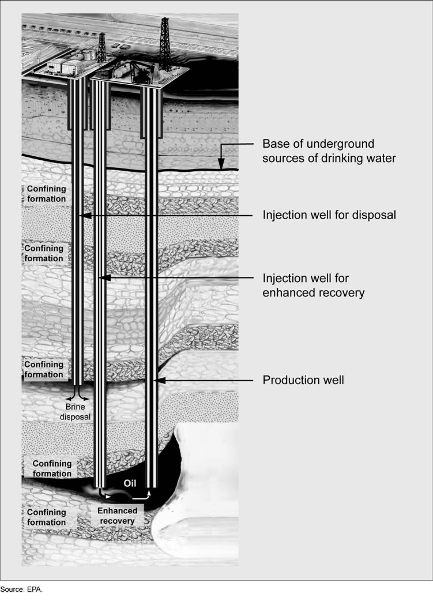 `injection-wells-diagram-01.jpg` | US GAO diagram of injection wells used to dispose of produced water underground. | U.S. Government Accountability Office from Washington, DC, United States | Public domain | U.S. Government Accountability Office from Washington, DC, United States / Wikimedia Commons (Public domain, attribution not required) | [file page](https://commons.wikimedia.org/wiki/File:Figure_2-_Injection_Wells_for_Produced_Water_(6847703607).jpg) |
| 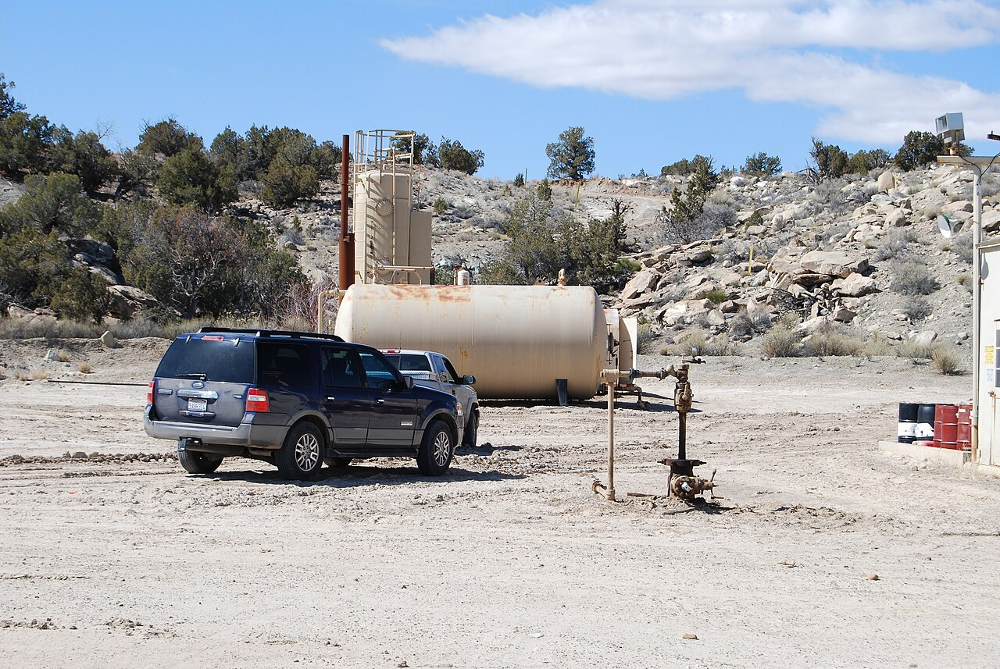 `water-injection-well-01.jpg` | Surface wellhead of a water injection well (Tin Cup 1-35). The caption says water injection only, but it is an oilfield wellhead, so check it fits before use. | trueblood (talk) | Public domain | trueblood (talk) / Wikimedia Commons (Public domain, attribution not required) | [file page](https://commons.wikimedia.org/wiki/File:Tin_Cup_1-35_Water_Injection_Well_631.jpg) |
| 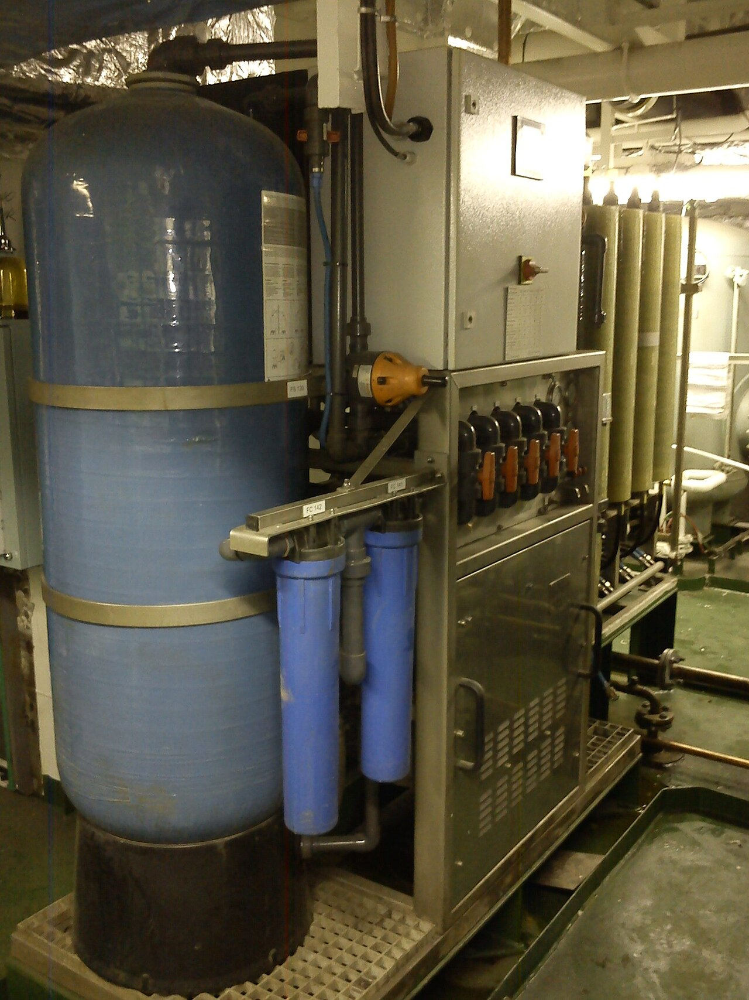 `reverse-osmosis-plant-01.jpg` | Reverse osmosis plant used to desalinate saltwater, the same core technology used to treat produced water. | Blueye | CC BY-SA 3.0 | Blueye / Wikimedia Commons, CC BY-SA 3.0 | [file page](https://commons.wikimedia.org/wiki/File:Reverse_Osmosis_Plant.JPG) |
| 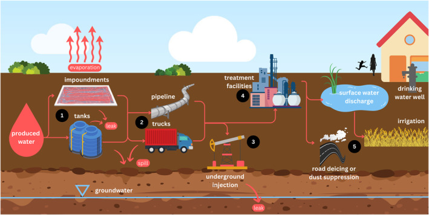 `produced-water-management-diagram-01.png` | USGS diagram of produced water management: collection and storage, transport, disposal in Class II injection wells, and treatment and reuse. | USGS, Environmental Health Program | Public domain (US federal work) | Figure: USGS, Environmental Health Program (public domain) | [file page](https://www.usgs.gov/media/images/produced-water-management-options-and-potential-routes-exposure) |

## Direct file URLs

The exact URL each file was downloaded from, for re-downloading at another size.

- `water-main-break-01.jpg`: https://thumb.wikimedia.org/wikipedia/commons/thumb/c/ce/2020_White_Plains_Water_Main_Break_20200810_%281%29.jpg/1280px-2020_White_Plains_Water_Main_Break_20200810_%281%29.jpg
- `burst-pipe-street-01.jpg`: https://thumb.wikimedia.org/wikipedia/commons/thumb/9/9c/Burst_pipe_in_Long_Eaton.jpg/1280px-Burst_pipe_in_Long_Eaton.jpg
- `pipeline-leak-spray-01.jpg`: https://thumb.wikimedia.org/wikipedia/commons/thumb/e/e2/Water_pipeline_leak_%40_Bord_de_Mars_01.jpg/1280px-Water_pipeline_leak_%40_Bord_de_Mars_01.jpg
- `pinhole-leak-rusted-pipe-01.jpg`: https://thumb.wikimedia.org/wikipedia/commons/thumb/f/f5/Leak_in_rusted_pipe_side_view.jpg/1280px-Leak_in_rusted_pipe_side_view.jpg
- `leaking-pipe-spray-01.jpg`: https://upload.wikimedia.org/wikipedia/commons/e/ec/A_spray_of_water_-_geograph.org.uk_-_1062472.jpg
- `street-water-leak-01.jpg`: https://thumb.wikimedia.org/wikipedia/commons/thumb/0/00/Water_leakage_at_Gr%C3%B8nland_torg_in_2026.jpg/1280px-Water_leakage_at_Gr%C3%B8nland_torg_in_2026.jpg
- `brine-spill-sampling-01.jpg`: https://d9-wret.s3.us-west-2.amazonaws.com/assets/palladium/production/s3fs-public/styles/full_width/public/thumbnails/image/hydraulic-fracturing-brine-spill-sampling_adj.jpg
- `brine-spill-winter-sampling-01.jpg`: https://d9-wret.s3.us-west-2.amazonaws.com/assets/palladium/production/s3fs-public/styles/full_width/public/thumbnails/image/wbs_ice_auger_dscn0057_l.jpg
- `brine-spill-site-measurements-01.jpg`: https://d9-wret.s3.us-west-2.amazonaws.com/assets/palladium/production/s3fs-public/styles/full_width/public/thumbnails/image/P2120682.JPG
- `salt-scar-produced-water-01.jpg`: https://d9-wret.s3.us-west-2.amazonaws.com/assets/palladium/production/s3fs-public/styles/full_width/public/thumbnails/image/site_b_salt_scar_l.jpg
- `salt-scar-monitoring-01.jpg`: https://d9-wret.s3.us-west-2.amazonaws.com/assets/palladium/production/s3fs-public/styles/full_width/public/thumbnails/image/OsageSiteB_BrinePitWells_l.jpg
- `fiberglass-water-tank-01.jpg`: https://thumb.wikimedia.org/wikipedia/commons/thumb/a/ab/GRP_TANK.jpg/1280px-GRP_TANK.jpg
- `frac-water-tanks-01.jpg`: https://thumb.wikimedia.org/wikipedia/commons/thumb/3/3d/Water_tanks_preparing_for_a_frac_job.JPG/1280px-Water_tanks_preparing_for_a_frac_job.JPG
- `fiberglass-tanks-02.jpg`: https://thumb.wikimedia.org/wikipedia/commons/thumb/e/e0/UMFS_fiberglass_tanks.JPG/1280px-UMFS_fiberglass_tanks.JPG
- `rusting-water-tank-01.jpg`: https://thumb.wikimedia.org/wikipedia/commons/thumb/f/fe/-2019-11-05_A_rusting_rain_water_tank%2C_Loop_Road%2C_Trimingham.JPG/1280px--2019-11-05_A_rusting_rain_water_tank%2C_Loop_Road%2C_Trimingham.JPG
- `tank-overflow-01.jpg`: https://thumb.wikimedia.org/wikipedia/commons/thumb/4/4c/Overflow_of_underground_greywater_collection_tank_%284361541139%29.jpg/1280px-Overflow_of_underground_greywater_collection_tank_%284361541139%29.jpg
- `centrifugal-pumps-01.jpg`: https://thumb.wikimedia.org/wikipedia/commons/thumb/a/ab/Centrifugal_Pump.jpg/1280px-Centrifugal_Pump.jpg
- `leaking-pump-seal-01.jpg`: https://upload.wikimedia.org/wikipedia/commons/1/16/Cummins_raw_water_pump_failure.jpg
- `centrifugal-pump-waterworks-01.jpg`: https://thumb.wikimedia.org/wikipedia/commons/thumb/5/5c/Gwynnes_centrifugal_pump_Brede_Waterworks.jpg/1280px-Gwynnes_centrifugal_pump_Brede_Waterworks.jpg
- `pump-station-interior-01.jpg`: https://thumb.wikimedia.org/wikipedia/commons/thumb/8/89/Tai_Hang_Tung_Flood_Storage_Flood_water_pumping_station_interior_2018.jpg/1280px-Tai_Hang_Tung_Flood_Storage_Flood_water_pumping_station_interior_2018.jpg
- `vacuum-truck-01.jpg`: https://upload.wikimedia.org/wikipedia/commons/c/c1/Vacuum_truck_%282920675027%29.jpg
- `water-tanker-truck-01.jpg`: https://thumb.wikimedia.org/wikipedia/commons/thumb/0/06/Tanker_truck_full_of_water.jpg/1280px-Tanker_truck_full_of_water.jpg
- `water-tanker-truck-02.jpg`: https://thumb.wikimedia.org/wikipedia/commons/thumb/6/61/FEMA_-_35037_-_FEMA_water_tanker_truck_in_Kansas.jpg/1280px-FEMA_-_35037_-_FEMA_water_tanker_truck_in_Kansas.jpg
- `water-depot-trucks-01.jpg`: https://d9-wret.s3.us-west-2.amazonaws.com/assets/palladium/production/s3fs-public/styles/full_width/public/thumbnails/image/838_Watford_H20_Depot.JPG
- `leak-detection-hydrant-01.jpg`: https://thumb.wikimedia.org/wikipedia/commons/thumb/1/10/Leak_detection_test_for_fire_hydrant_-_Arlington%2C_MA.jpg/1280px-Leak_detection_test_for_fire_hydrant_-_Arlington%2C_MA.jpg
- `leak-correlator-search-01.jpg`: https://thumb.wikimedia.org/wikipedia/commons/thumb/c/c8/Recherche_d%27une_fuite_d%27eau_%C3%A0_l%27aide_d%27un_Hydreka_MicroCorr%2C_Mont%C3%A9e_de_la_Paroche_%C3%A0_Saint-Maurice-de-Beynost_%28avril_2019%29.jpg/1280px-Recherche_d%27une_fuite_d%27eau_%C3%A0_l%27aide_d%27un_Hydreka_MicroCorr%2C_Mont%C3%A9e_de_la_Paroche_%C3%A0_Saint-Maurice-de-Beynost_%28avril_2019%29.jpg
- `leak-correlator-search-02.jpg`: https://thumb.wikimedia.org/wikipedia/commons/thumb/e/e0/Recherche_d%27une_fuite_d%27eau_%C3%A0_l%27aide_d%27un_Hydreka_MicroCorr%2C_Mont%C3%A9e_de_la_Paroche_%C3%A0_Saint-Maurice-de-Beynost_%28avril_2019%29_-_%282%29.jpg/1280px-Recherche_d%27une_fuite_d%27eau_%C3%A0_l%27aide_d%27un_Hydreka_MicroCorr%2C_Mont%C3%A9e_de_la_Paroche_%C3%A0_Saint-Maurice-de-Beynost_%28avril_2019%29_-_%282%29.jpg
- `ground-microphone-01.jpg`: https://upload.wikimedia.org/wikipedia/commons/6/67/Geofonelight.jpg
- `inspecting-water-leak-01.jpg`: https://thumb.wikimedia.org/wikipedia/commons/thumb/0/0b/Sailor_Checks_On_Water_Leak_%287202820%29.jpg/1280px-Sailor_Checks_On_Water_Leak_%287202820%29.jpg
- `injection-wells-diagram-01.jpg`: https://thumb.wikimedia.org/wikipedia/commons/thumb/8/85/Figure_2-_Injection_Wells_for_Produced_Water_%286847703607%29.jpg/1280px-Figure_2-_Injection_Wells_for_Produced_Water_%286847703607%29.jpg
- `water-injection-well-01.jpg`: https://thumb.wikimedia.org/wikipedia/commons/thumb/8/82/Tin_Cup_1-35_Water_Injection_Well_631.jpg/1280px-Tin_Cup_1-35_Water_Injection_Well_631.jpg
- `reverse-osmosis-plant-01.jpg`: https://thumb.wikimedia.org/wikipedia/commons/thumb/7/77/Reverse_Osmosis_Plant.JPG/1280px-Reverse_Osmosis_Plant.JPG
- `produced-water-management-diagram-01.png`: https://d9-wret.s3.us-west-2.amazonaws.com/assets/palladium/production/s3fs-public/styles/full_width/public/media/images/Picture1_31.png

## Gaps

- Brine spills: Wikimedia Commons has almost no openly licensed photos of produced water or brine spills, so all five come from USGS.
Most show scientists sampling spill sites in winter, and only two show dead, salt-scarred ground.
There is no close-up of fresh brine pooled on soil or of active spill cleanup with vacuum trucks.
- Oilfield water trucks: no openly licensed photo of a dedicated oilfield produced water truck was found.
The USGS Watford depot photo is the only oilfield one, and the other trucks are municipal water and vacuum trucks.
- Saltwater disposal facilities: no open photo of an actual saltwater disposal (SWD) facility with its unloading bays, tanks, and injection pumps was found.
This section relies on two diagrams, one injection wellhead, and a reverse osmosis plant as a stand-in for produced water treatment.
- Wet patch above a buried line: the Oslo street leak is the closest match.
There is no photo of a wet or green patch of ground above a buried leaking pipeline in open country.
- Leaking flanges: no clear openly licensed photo of a leaking flanged joint on a water pipe was found.
- Pumps: the photos show building, waterworks, and engine pumps, not an oilfield transfer pump skid.
- Tanks: there is no open photo of a fiberglass oilfield water tank with leak streaks, so the rusting rainwater tank is the closest match.
- These images were selected from their file page descriptions and were not opened, so look at each one before using it in the deck.
